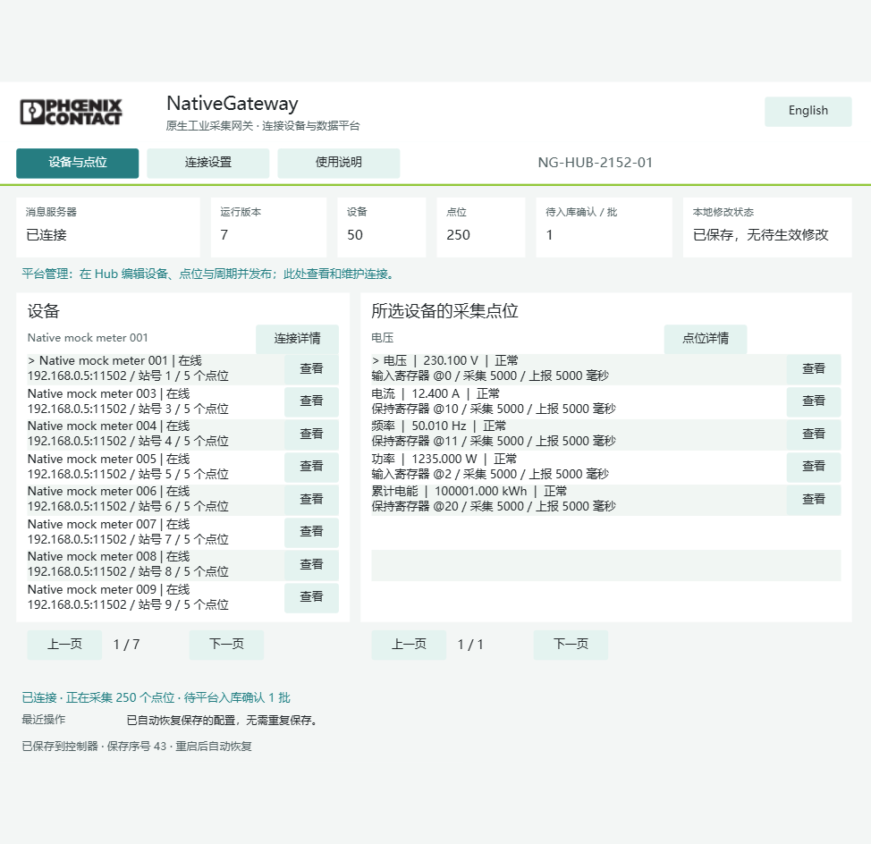

# NativeGateway 双语 HMI 与自动恢复验证

程序 `native-0.4.0`，2026-10-23，AXC F 2152 `192.168.0.8`。Engineer 原生编译最终通过：**0 错误、0 警告**，已下载。验证配置仍为 v7、50 台设备、250 个点位，每点采集和上报周期均 5000 毫秒。

## 界面与使用流程

访问：<https://192.168.0.8/ehmi/hmiapp.html>。

- Logo 使用用户补充的独立 Phoenix Contact 黑白图片，未修改图片内容、未拼入原配色圆点。打包资源与原文件逐字节匹配。
- 绿色与青绿色配浅背景、深色正文。主入口为“设备与点位”“连接设置”“使用说明”。
- 名称、实时值和中文状态优先，内部标识放在详情；实时运行状态和最近操作分开。
- Hub 管理模式显示只读点表，明确到 Hub 编辑并发布。程序侧也拒绝本地保存和生效命令。
- 独立模式保留增删编辑：编辑 → 保存到待生效配置 → 检查 → 确认生效并保存到控制器。放弃草稿、删除和连接设置保存均有清楚的确认页。
- 数据类型、寄存器区域、上报方式用带说明的选项按钮。身份、模式和时区归入高级设置，切换身份的清空点表后果在确认页说明。
- 中英文切换覆盖固定文案、列表状态和操作提示；中文界面保留必要技术名与用户命名。显示采用宽字符串与长度保护，协议和持久化布局不变。
- 语言和选中页面为控制器共享会话状态，重启默认中文。原生画布适合桌面和平板，窄屏等比缩放，不声称手机响应式重排。

截图：

界面验证包含语言切换、设备/点位详情、使用说明、连接确认导航和 Hub 本地写入保护；结果见 `final/ui-workflow.json`。本次没有在活动 Hub 网关上切换为独立身份，以免清空正式联调点表。独立模式的既有增删实测记录继续保留。

## 通信中断恢复

测试范围：停止本机 Docker `mosquitto` 的 1883 服务，并暂停本测试独占的 mock 进程（PID/命令行/11502 监听归属均校验），保留寄存器状态。PLC 管理 LAN 保持可达。该测试覆盖 broker TCP 断开与 Modbus 无响应超时，**不是物理拔网线测试**。

操作窗口 12:31:18～12:32:28，共 70.05 秒（含准备与恢复）；实际暂停循环 60 秒。恢复后未重新下载、未手动重连、未重新下发配置。

| 恢复指标 | 实测 |
|---|---:|
| broker 自动重连 | 4.03 秒 |
| 全部 250 点恢复正常且数值正确 | 4.03 秒 |
| 首批恢复后数据到 broker | 2.36 秒 |
| 首个真实 Hub 入库回执 | 11.53 秒 |
| 250 点新样本完整入库覆盖 | 24.36 秒 |

恢复观察窗口捕获 28 个唯一数据批次，22 批取得真实 STORED，250 点覆盖。PLC 启动身份不变，MQTT 会话计数 2→3；丢弃 0、无效回执 0、死批次 0，错误数值和协议错误均为 0。

## 控制器系统重启恢复

12:36:56 调用供应商 `IDeviceControlService.RestartDevice`，执行控制器操作系统重启。端口探测实际记录到 RSC 服务不可达；这次不是 IEC 程序暖启动。未重新下发配置。

| 恢复指标（从重启命令开始） | 实测 |
|---|---:|
| broker 自动连接 | 134.28 秒 |
| 全部 250 点正常、数值正确 | 131.15 秒 |
| 首批新启动数据到 broker | 133.12 秒 |
| 首个真实 Hub 入库回执 | 134.95 秒 |
| 250 点新启动样本完整入库覆盖 | 145.1 秒 |

启动计数 17→18，v7、配置消息标识和 50×5 点表恢复一致，`ReceivedConfigs=0`。重启窗口 10 批获得真实 Hub STORED，协议错误/错误数值均 0。随后通过原 Hub API 逐台读取全部 50 台、250 个活动 v7 最新值，均为新启动身份、GOOD 且符合预期；查询时样本年龄 9.24～19.03 秒。原接口还返回 1 条旧版本历史点位记录，已单独保留在 raw 证据中，按活动版本筛选后验收，不把历史记录混入当前点表。

首个 STORED 的时间只关联本阶段已捕获的数据消息标识，排除重启前在途批次的延迟回执；原始报文保留，初次派生统计另存为 `*-initial-derived-result.json`。网络复测后的最后一次下载仅改变显示拼接长度保护与按钮按下配色；Main、MQTT、Modbus、持久化源码哈希与断链通过版本相同，最终包再完成系统重启与入库验证。

## 资源、日志与限制

从有效通信中断开始到重启后的 Hub 查询结束，观察 626.66 秒，资源每 10 秒记录，共 52 条（系统重启期间允许采样缺口）。CPU 32.0～65.0%，均值 44.21%；实际内存 57～70%，首/末 70/69%；IEC 程序 0.0～9.0%，IEC 数据 0.0～39.0%。原始资源另有 `memoryUsagePercent`，包含系统缓存等，与这里的 `actualMemoryPercent` 不是同一指标。

中断复测时发现并修复了较短 MQTT 错误文本被 `LEFT(...,24)` 越界截取的问题，改为截取不超过实际长度。修复前最后一批字符串错误为 12:24:56，复测与最终重启后核对日志没有更晚同类记录，历史证据保留。

测试中另有真实异常：关闭并重开 mock 监听的较早测试出现 9 条瞬时零值，未判通过。mock 源码在开放监听时先把寄存器初始化为零，后续采样再填入设定值。原始报文保留于 `final/blackout-wire.jsonl`，分析为 `final/blackout-wire-analysis.json`。后续采用保留寄存器状态的进程暂停，避免把 mock 重建初始化混入通信断链测试；未改 mock 业务源码。

配置自动恢复已经验证；遥测队列仍是 16 批 RAM，不保证重启前未确认数据不丢，也不保证断网期间每次采样都保留。停止 broker 会影响所有使用这个本机测试 broker 的客户端，测试后已恢复。结果不等于物理断电验证，也不等于完成原 8 小时长测；此前长测的 HMI 短暂不可用历史问题仍保留，不能据本次短测宣布长期稳定。

主要证据：`tests/hmi-recovery-20261023/verified/RESULTS.json`、`blackout-result.json`、`reboot-result.json`、`hub-latest-verification.json`、各阶段 `*-wire.jsonl`、PLC 点值快照、重启端口探测，以及 `tests/hub-runtime/controller-resources.jsonl`。记录器只读，STORED 由真实 Hub 发出。

最终工程 SHA256：`b78ba0efd0f8f79558143d58f3eb141512876690b2eda2a641e96ba3a3cbaddf`。

仓库附带精简结果 `tests/validation/` 及界面截图 `docs/images/`；原始报文和持续采样保留于原工作站，不随 Git 上传。
