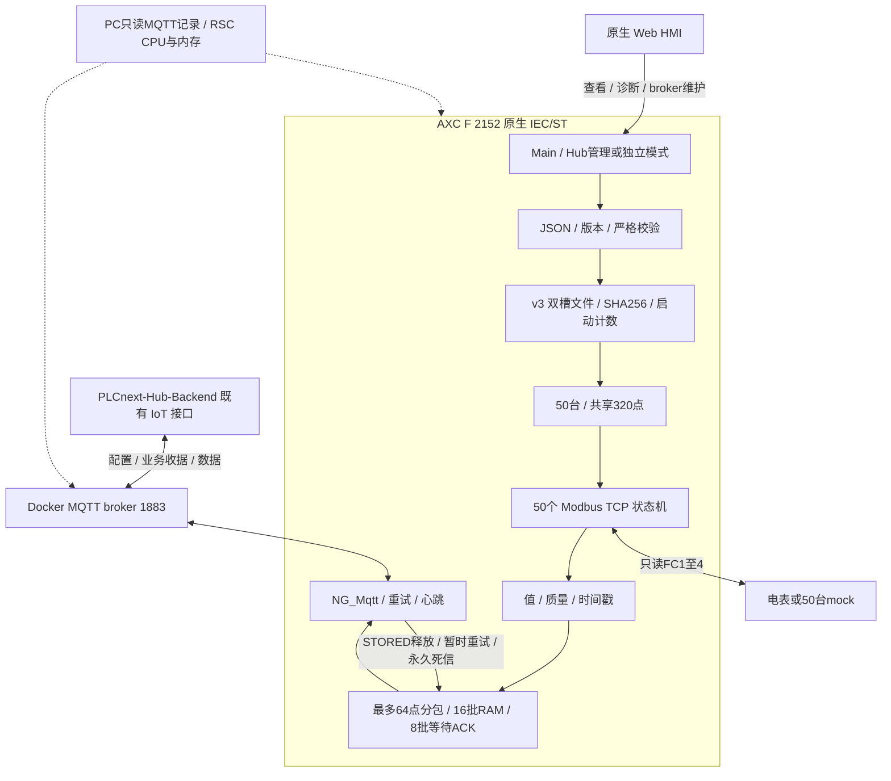

# NativeGateway 项目说明

原生 IEC/ST + PLCnext Engineer Web HMI 的 Modbus TCP / MQTT 采集网关

文档版本：1.4　|　程序版本：native-0.5.0　|　日期：2026-10-23

维护版说明：当前以 Hub 管理为主。原 8 小时长测已由用户提前结束，有效观察 38 分 50.6 秒；不可判定 8 小时通过。该段完整证据已归档，维护期间的下载、调试和 Hub 测试另行记录。下文历史 v104 表格保留为历史实测，不能当作 v0.3 的验收结果。PDF 为 v0.2 历史导出，尚未更新。

本文面向项目维护人员、PLC 工程师、上位机开发人员和联调人员。内容以本工程源码、工程生成工具、参考项目协议及已有实测文件为依据。

## 1. 项目目标与交付范围

NativeGateway 在 AXC F 2152 上采集局域网 Modbus TCP 电表或其他只读设备的数据，转换成统一的带质量码和时间戳的点位数据，再通过 MQTT 发给 broker。设备连接、采集点表和采集/上报周期可由 Web HMI 修改，也可由远程平台通过 MQTT 下发。

采集、配置解析、版本检查、持久化、数据组批和 MQTT 收发全部运行在 PLC 原生 IEC/ST 中。PC 上的 Python 和 Java 仅承担模拟设备、协议验证、业务回执模拟和独立资源记录，不是 PLC 采集 Agent。

当前交付包括 `NativeGateway.pcwex` 工程、可维护的 ST/数据类型源码、原生 Web HMI 页面、工程重建工具、模拟设备配置、联调脚本、实测结果与持续运行记录。未交付 PLCnext Store App 安装包、生产 Hub 数据库或生产账号体系。

| 能力 | 当前实现与验证情况 |
|---|---|
| Modbus TCP 只读采集 | 原生 TCP 状态机；50 个逻辑设备、250 点已验证 |
| MQTT 全量/增量配置 | 实现 config/set、config/patch；设备增删改及周期修改 |
| HMI 设备/点位管理 | 分页列表、选择、新增、编辑、删除确认、草稿与持久化已实测 |
| 本地配置恢复 | 双槽文件与 SHA256 回读；清除 broker 保留配置后重启恢复已实测 |
| 数据回执与重发 | QoS 1 加业务 ACK；16 批 RAM 队列，满时背压 |
| 长期稳定性 | 8 小时测试提前结束；短段结果见 tests/soak/STABILITY-RESULTS.txt |

### 当前配置归属和可靠性边界

`HUB_MANAGED` 是默认平台管理模式，禁止 HMI 本地提交点表与周期。`STANDALONE` 在界面中显示为“本地维护”，支持手动接管和本地增删改。通过“管理与维护”切换时保持网关标识，不重连 broker，默认保留当前点表；进入维护时可明确选择清空本地点表，但保留平台备份。模式保存于控制器，不随 Hub 在线、断线或重启自动改变。详情查看、broker 和时区维护仍保留。

当前持久化使用 `/opt/plcnext/NativeGateway-v4-A.bin` 和 `NativeGateway-v4-B.bin`，同时保存平台配置备份、本地改动标记、本地修订号、管理模式和启动计数。无有效 v4 时按 v3、v2、v1 顺序只读迁移，旧文件保留。v3 迁移保持网关、启动计数、配置与请求记录；原平台配置成为平台备份。必须先完成启动计数持久化才开始 MQTT，以网关摘要、启动计数和序号生成消息标识。

业务 ACK 严格检查 schema、网关、消息 ID、状态和错误列表。仅 `STORED` 移除已发送批次；`UNKNOWN_CONFIG_VERSION`、`RESOURCE_LIMIT`、`STORAGE_ERROR` 延后 60 秒重试，其他合法永久拒绝保留为 RAM 死信。非法 ACK 忽略并计数。最多 8 批等待业务 ACK，首次等待 30 秒，重发后等待 60 秒；保持原始 messageId 和报文字节。死信也占 16 批总队列，可能触发背压，不能当作已交付或默默丢弃。

这些改动对齐 Hub 的既有 IoT 协议，但不表示与 Python Agent 的全部运维能力相同：遥测仍未落盘，断电可能丢失未确认 RAM 批次；库的 Will payload 只有 80 字节，完整协议遗嘱未启用，Hub 依据心跳超时离线。容量仍为 50 台、共享 320 点、每台最多 32 点；v0.3.1 每批最多 64 点且受约 12KB 值区限制，配置入站 131071 字节，仅支持 Modbus TCP IPv4。

## 2. 系统架构与职责



电表与 PLC 之间使用 Modbus TCP，PLC 与 broker 之间使用 MQTT，上位机通过同一 broker 管理配置并接收数据。Web HMI 直接读写 PLC 暴露的 HMI 标签；它不通过 PC 的测试脚本保存配置。

### 2.1 PLC 内部模块

| 模块 | 作用 |
|---|---|
| `Main` | 协调启动恢复、配置事务、50 个采集实例、组批、发送与回执队列 |
| `NG_Mqtt` | IIoT Library MQTT 客户端封装、订阅、发布、连接检查和重连 |
| `NG_JsonParse` / `NG_Command` | 分周期 JSON 解析、字段检查、全量/增量配置候选值生成 |
| `NG_ReadConfig` / `NG_ReadDevice` / `NG_ReadPoint` | 把 JSON 对象转换为原生类型 |
| `NG_CheckConfig` / `NG_EditDevice` | 约束检查、点池压缩、设备/点位偏移更新 |
| `NG_Modbus` | 每设备独立 TCP 连接；台内逐点轮询、解码和质量管理 |
| `NG_HmiEdit` | 活动配置到草稿、界面操作、版本冲突和提交校验 |
| `NG_Store` / `NG_SHA256` | 配置双槽存储、哈希回读验证、旧格式迁移及恢复 |

### 2.2 运行方式

工程生成工具把主任务设置为 20 ms 周期、500 ms 看门狗。50 个 `NG_Modbus` 实例在同一个循环任务中以非阻塞状态机推进，并不是 50 个 IEC 线程。每台设备独立保持连接，同台设备的点位串行采集。

JSON 解析每次调用最多推进约 512 个输入字符，降低大配置在单个周期内独占任务的风险。解析后的语义检查、候选配置构建与文件处理仍有开销；50 台完整配置的应用耗时应按实测评估，不能按 20 ms 周期推断配置会在 20 ms 内完成。

### 2.3 PC 侧测试组件

| 组件 | 职责及边界 |
|---|---|
| Docker `mosquitto` | 既有 MQTT broker，宿主机暴露 1883 |
| `PLCnext-mock-device` | Modbus TCP 模拟服务和配置 API，模拟 Unit 1～50 |
| `soak_observer.py` | 保存 wire 报文、校验协议和预期值，模拟 STORED 回执 |
| `ResourceRecorder.java` | 每 10 秒通过控制器状态服务读取 CPU、内存和温度 |
| `web_probe.py` | 每 15 秒只读检查 80/443 端口及 HTTP 跳转 |
| Codex 监测任务 | 定期检查本地证据，异常或结束时通知；不替代实际记录器 |

## 3. 环境、版本与网络

| 项目 | 当前联调值 |
|---|---|
| 工程目录 | `D:\work\code\PLCnext-Engineer` |
| Engineer | PLCnext Engineer 2026.0.4 |
| 控制器 | AXC F 2152；`192.168.0.8` |
| PC 以太网地址 | `192.168.0.5` |
| PLC 程序版本 | `native-0.4.0` |
| 历史稳定性配置 | v104；`messageId=soak-50x5-104`，已归档 |
| 持久化格式 | FormatVersion 3，与程序版本、配置版本分别管理 |
| MQTT 库 | 工程中的 IIoT Library 5.3；使用 `IIoT_MqttClient_6` |
| Web HMI | `https://192.168.0.8/ehmi/hmiapp.html` |

| 通信关系 | 目标地址/端口 | 说明 |
|---|---|---|
| PLC → broker | `192.168.0.5:1883` | 当前匿名 MQTT TCP 联调 |
| PLC → 模拟电表 | `192.168.0.5:11502` | Unit ID 1～50，50 个逻辑设备共用一个服务 |
| 浏览器 → HMI | `192.168.0.8:443` | HTTPS；80 当前返回 301 跳转到 HTTPS |
| PC → mock 管理 API | `127.0.0.1:18080` | `/api/v1/config` |
| PC → 控制器状态服务 | `192.168.0.8:41100` | 独立资源记录 |

PLC 中的 `127.0.0.1` 指 PLC 本机，不能用它连接 PC 的 broker 或 mock。PC 测试记录器可使用 `127.0.0.1:1883`，因为 broker 在该 PC 上。

此处的 50 台是 50 个独立设备配置、50 个 Unit ID 和 50 个 PLC TCP 连接，实际接入的是同一个 PC mock 服务。它证明该逻辑负载下的能力，不等同于已验证 50 台不同厂家实体电表及真实网络抖动。

## 4. 数据模型与容量约束

### 4.1 核心对象

`NG_Config` 保存版本、消息 ID、采集总开关、组批参数、设备列表和共享点池。`NG_Device` 用 `PointStart` 与 `PointCount` 描述自己的点池范围；`NG_Sample` 保存运行值、质量、时间戳及下一次采集/上报调度信息。

共享点池避免为每台设备固定分配 32 个完整点对象。删除设备或点位时，`NG_EditDevice` 压缩点池，并重新计算后续设备的点位起始位置。

| 限制 | 当前值及含义 |
|---|---|
| 设备数 | 最多 50 台 |
| 总点数 | 最多 320 点，所有设备共享 |
| 每台点数 | 最多 32 点；50 × 32 不可同时配置 |
| 本次长测负载 | 50 × 5 = 250 点 |
| 配置消息长度 | 最多 131071 字节；大于此值不能因为参考协议允许 2 MiB 就视为可用 |
| JSON token | 最多 8192 个；仍会限制实际可容纳的复杂配置 |
| JSON 深度 | 最多 64 层；拒绝重复成员键 |
| JSON 普通字符串 | 解析器 STRING 文本长度最多 256；成员键最多 64；业务字段可能更小，中文 UTF-8 字节长度也需留意 |
| 设备/点位/消息 ID | 1～64 字符；首字符字母或数字，后续可包含 `.`、`_`、`-` |
| 数据组批 | 每批最多 64 点；maxBatchPoints 更小或值区达到约 12KB 时提前分包 |
| 待回执队列 | 16 批，RAM 内保存，不跨重启 |
| 请求重放记录 | 最近 32 条请求，随配置状态持久化 |

来自 MQTT 的 `maxBatchPoints` 语义校验允许 1～500，但发送路径硬限制为 64，且值区达到约 12KB 时提前分包。独立 HMI 可设置 1～64。填写 100 不会产生一包 100 点。边界能力以原生源码与实际报文为准。

### 4.2 设备字段

| 字段 | 类型/约束 | 含义 |
|---|---|---|
| deviceId / name | ID / 1～128 字符 | 配置主键及显示名称 |
| enabled | Boolean | 设备采集开关 |
| protocol | `modbus_tcp` | 当前仅实现该采集协议 |
| connection.host | IPv4 文本 | 当前不解析域名或 IPv6 |
| connection.port | 1～65535 | 实体电表常见 502；mock 使用 11502 |
| connection.unitId | 0～255 | 按设备寄存器表设置；mock 为 1～50 |
| connectTimeoutMs | 1～300000 | 连接超时 |
| requestTimeoutMs | 1～300000 | 一次请求发送/响应期限 |
| retryCount | 0～10 | 当前只对 BAD_PROTOCOL 进行同点立即重试 |
| points | 点对象数组 | 每台最多 32 点，受共享点池总量限制 |

### 4.3 点位字段

| 字段 | 类型/约束 | 含义 |
|---|---|---|
| pointId / name | ID / 1～128 字符 | 点位主键；pointId 在设备内唯一 |
| enabled | Boolean | 点位采集开关 |
| dataType | 见 Modbus 类型表 | 原始值解码类型 |
| pollIntervalMs | 1～86400000 | 采集间隔，毫秒 |
| reportIntervalMs | 1～86400000 | 周期上报间隔，毫秒 |
| scale / offset | 有限数值 | 输出值 = 原始值 × scale + offset |
| unit | 可选，最多 32 字符 | 显示/配置单位；data 报文不逐点携带单位 |
| reportMode | cyclic / change / change_or_cyclic | 上报触发方式 |
| deadband | 非负数 | 变化阈值；实现使用绝对差严格大于该值 |
| staleAfterMs | 1～86400000，且不小于 pollIntervalMs | GOOD 值过期门限 |
| modbus.area | 四类区域之一 | 决定 Modbus 功能码 |
| modbus.address | 0～65535 | 零基寄存器/位地址；还需检查数据宽度不越界 |
| modbus.byteOrder | 按类型填写 | 16 位 AB/BA；32 位四种顺序；bool 留空 |

MQTT 点位配置的 scale、offset 绝对值及 deadband 上限为约 1E100；HMI 对这三个字段的输入限制更保守，为约 1E20。配置允许的数值范围不构成任意组合运算都不会溢出的保证，真实工程应使用电表合理量程。

## 5. 配置事务、版本与并发

### 5.1 配置生效流程

1. MQTT 收到配置后，先在原生程序中分周期解析 JSON，并计算原始 payload 的 SHA256。
2. 检查 gatewayId、schemaVersion、字段、设备/点位容量、寄存器范围和版本基线。
3. 在候选对象中构建新配置，保留当前活动配置继续运行。
4. 将候选状态写入另一个持久化槽，关闭后重新打开、读取并验证长度、格式与 SHA256。
5. 验证成功后更新活动配置，重置采集实例和样本，随后发 APPLIED 回执。
6. 保存失败返回 FAILED / STORAGE_ERROR，原活动配置不切换。

应用大配置期间，采集状态机仍会推进，但共用的接收/解析协调器暂时不能及时处理 data/ack。队列满时暂停新组批，保留待上报状态；事务完成并处理回执后继续。容量复测已实际触达 16 批上限，丢弃保持 0。

### 5.2 三种版本不能混用

| 名称 | 示例 | 变更原因 |
|---|---|---|
| 程序版本 agentVersion | native-0.4.0 | ST/HMI 软件实现变更 |
| 配置版本 configVersion | 104 | 设备、点位或网关组批配置被应用 |
| 文件格式 FormatVersion | 3 | 二进制持久化布局变更；支持读取旧 v2/v1 |

配置版本必须递增；增量配置还必须同时匹配当前 `baseConfigVersion` 和 `baseMessageId`。HMI 应用也增加配置版本，因此上位机不能长期硬编码基线版本。

### 5.3 幂等、回放与冲突

同一 messageId、版本、消息种类和原始 payload 哈希匹配时，可返回已处理回执。重试应重发完全相同的字节，不要修改 timestamp、空格或字段顺序后继续复用 messageId。

同一个 messageId 携带不同内容会产生 VERSION_CONFLICT。旧版本通常为 STALE_VERSION；已识别的历史增量回放返回 APPLIED 不表示当前活动配置回滚。判断当前状态应看 activeConfigVersion 与 config/get 的 activeMessageId。

### 5.4 HMI 与远程平台同时编辑

HMI 编辑基于当前活动版本形成草稿。无未保存修改时，新 MQTT 配置会使草稿自动刷新；存在修改时保留草稿并检测版本冲突。冲突后重新载入活动配置，再编辑和提交。

Broker 的 retained config/set 不会自动跟随 HMI 修改。上位机需读取 config/get 同步版本，再发布更高版本的期望配置；旧 retained 消息在 PLC 重启后可能被正确拒绝。

## 6. Web HMI 使用说明

当前地址：`https://192.168.0.8/ehmi/hmiapp.html`。原生 Engineer 画布为 1280 × 1000，适合桌面和平板维护；由浏览器等比缩放，不是手机端响应式重排。使用用户指定的独立 Phoenix Contact 黑白 Logo；品牌绿与青绿作为界面强调色。

本工程按此前用户要求临时关闭 HMI 登录。80 端口仍会跳转 HTTPS 443。首次自签名证书提示由用户处理；没有增加自有账号或操作审计系统。

### 6.1 查看运行状态、设备与点位

主导航为“设备与点位”“连接设置”“使用说明”。顶部卡片显示消息服务器连接、活动配置版本、设备数、点数、待入库确认批次和本地修改状态。底部实时状态、最近操作、配置保存结果分别显示，启动历史消息不会代替实时连接状态。

设备和点位均每页最多 8 行。先查看设备，再查看该设备点位；名称、数值和中文质量状态优先显示。唯一标识、寄存器地址、字节序等在“连接详情”“点位详情”查看。技术标识与用户自定义名称不会被自动改写。

`HUB_MANAGED` 为主：HMI 设备/点位详情只读，本地新增、删除、保存和生效按钮隐藏，PLC 程序也拒绝本地写入命令。请在 Hub 编辑设备、点位、采集周期、上报周期，再发布；无本地待生效修改时列表自动跟随活动配置更新。

### 6.2 本地维护：新增、编辑和生效

先从“管理与维护”进入维护，默认选择“保留设备与点位”，无需更换网关标识。以下操作仅在本地维护开放。

1. 点击“新增设备”，填写唯一标识、名称、IPv4 地址、端口、站号与超时。
2. 输入完毕按 Enter 提交字段，点击“保存设备到待生效配置”。
3. 为该设备新增点位。数据类型、寄存器区域、上报方式使用带说明的选项按钮；不用手工记忆协议枚举。
4. 设置零基地址、字节序、倍率、单位、采集/上报周期、死区和过期时间，保存点位到待生效配置。
5. 返回列表，点击“使配置生效”，检查确认页，再点击“确认生效并保存到控制器”。校验和持久化成功后，采集使用新配置，重启自动恢复。有平台基线时仅增加本地修订号，平台版本和消息标识不变；无平台基线的独立配置仍使用本地版本。
6. 核对点位正常和数值。已对接平台的本地点表生效修改后，继续本地采集，暂停生成平台遥测和设备状态事件，避免把本地定义的数据作为原平台版本入库。原已排队的平台批次仍可取得真实回执。交还管理后恢复平台上报。

“保存到待生效配置”只编辑草稿，还不改变运行采集。详情字段输入后未点击保存的内容也还不属于草稿。离开编辑前应先保存。

### 6.3 删除与放弃修改

在详情页点击删除进入确认页；删除设备会把它的所有点位一起从草稿移除。仍需“使配置生效”才会停止运行采集。

“放弃草稿 / 更新显示”表示使用当前运行配置覆盖本地待生效修改。有草稿时会显示独立的放弃确认页；没有草稿时只更新显示。它不会读取并应用 broker 的旧消息，也不会撤销已经生效的配置。平台模式下列表本就自动更新，因此不显示此本地草稿操作。

### 6.4 连接、周期与配置归属

“连接设置”先展示服务器地址、客户端标识、用户名与密码，检查确认后再保存并自动重连。密码留空保留已有密码，保存后清空输入框。断线自动重试，无需重复保存。

“管理与维护”为独立入口。进入维护默认保留设备和点位，可明确选择清空；仅清本地点表，不删除 Hub 设备，平台备份保留。交还管理的确认页明确：本地改动与草稿不会上传 Hub，将恢复最近生效的平台备份，再继续平台发布。被拒绝的发布需在 Hub 重试。没有平台备份时保留本地采集，等待首次平台配置。连接保存不改变管理模式；仅主动更换网关标识仍会重置点表与请求历史。

平台模式的采集、上报和组批参数请在 Hub 修改并发布。本地维护保留设备内全部点位周期设置，以及“本地采集与组批设置”；组批参数同设备草稿一起确认生效。多个设备的点位可出现在同一上报批次中。

### 6.5 维护与版本冲突

平台基线（版本、消息标识、完整点表）与本地维护修订分别保存。本地草稿校验平台版本和本地修订号；旧草稿不能覆盖更新配置。本地改动不占用平台版本，不写入平台请求回放历史。

维护期间包括重复投递的合法配置请求均返回 `REJECTED`、标准错误码 `VERSION_CONFLICT`，说明要求交还平台后重试；不修改点表、不伪造成功。维护状态跨断线和重启保留。交还时在同一持久化事务中恢复平台备份，解除本地改动标记，恢复平台版本及消息标识，继续按原 `baseConfigVersion` / `baseMessageId` 检查增量发布。

本地点表与平台基线不一致时，心跳以 `WAITING_CONFIG` 表示暂不按平台配置上报，配置版本报告 0、设备列表和点计数为空；维护期间暂停 `config/get`。若维护期间重建 MQTT 会话，Hub 可能先提示能力/身份等待同步；交还后正常心跳和配置请求重建会话证据，再使用 Hub 原有重试接口。拒绝的发布不会在后台冒充已应用，也不会自动合并进本地改动。

### 6.6 中英文切换与显示实现

右上角切换中文/English。固定文案和界面状态均提供两种语言；中文界面保留品牌名、Hub、IP、单位、类型和字节序等必要技术标识，不改 MQTT 主题或枚举。中文显示采用 `NG_UiLabel` 宽字符串，`NG_UiText` 负责翻译，`NG_UiJoin` 有长度边界保护。协议和持久化数据结构未因语言功能改变。

语言、选中设备与页面状态为控制器共享的 HMI 会话状态，不是每个浏览器各自独立；多个操作员会相互影响。重启默认中文。配置的可靠恢复与浏览器显示语言分别管理。

### 6.6 断线与重启

消息连接失败后重试，Modbus 采集任务继续调度；设备连接失败会出现中文连接异常/请求超时状态。网络恢复后自动重新连接、采集和上报。系统重启从双槽配置恢复，不依赖重新发布配置。内存发送队列不跨重启保存，也不保证离线期间每次采样都能保留。

本次故障注入范围、实际恢复时间、资源记录与测试中发现的 mock 初始化问题见 [HMI 与自动恢复验证](HMI与自动恢复-20261023.md)。软件通信故障测试不等于物理拔网线或断电测试，原 8 小时测试也未因此补足。

## 7. Modbus TCP 通信

### 7.1 区域、地址和类型

| area | 功能码 | 类型 |
|---|---|---|
| coil | 01 | bool |
| discrete_input | 02 | bool |
| holding_register | 03 | int16、uint16、int32、uint32、float32 |
| input_register | 04 | int16、uint16、int32、uint32、float32 |

地址使用协议零基地址。电表说明中的 40001 往往对应 holding_register 的 address=0，30001 往往对应 input_register 的 address=0；必须以厂家寄存器表的基址说明为准，不要直接把 40001 当作地址 40001。

16 位类型占 1 个寄存器；32 位类型占 2 个，32 位点位的起始地址最多为 65534。bool 当前每次读一位，scale 必须为 1、offset/deadband 为 0，byteOrder 留空。

| byteOrder | 对原始四字节 A B C D 的解释 |
|---|---|
| AB / BA | 16 位不交换 / 交换字节 |
| ABCD | 32 位保持顺序 |
| BADC | 每个寄存器内交换两个字节 |
| CDAB | 交换两个寄存器 |
| DCBA | 四字节完全反转 |

float32 按 IEEE 754 解码，NaN/Infinity 位模式标记为 BAD_DECODE；整型先做有符号转换，再计算 scale 与 offset。数据报文中的数值是工程量，不是原始寄存器数组。

### 7.2 请求与响应处理

每个请求为一个点位构造 MBAP 与 PDU，检查事务 ID、协议 ID、Unit ID、功能码、长度和字节数。接收路径累积 TCP 分片后再解码，不依赖一次 receive 就收到完整帧。

当前逐点发请求，不按连续地址合并读取。Modbus 异常响应、帧检查失败等归类为 BAD_PROTOCOL，不把厂家异常码展开为单独业务错误字段。当前没有 Modbus 写功能、RTU、float64、字符串寄存器或设备域名解析。

### 7.3 调度与重试

成功/失败完成后，用当前单调时间加 pollIntervalMs 决定下一次到期时间。实际周期包括状态机推进、网络响应和同台其他点位的等待时间，因此配置 1000 ms 不等于每点严格 1000 ms 的硬实时承诺。

连接失败后约 2 秒再试；请求超时或连接故障触发关闭并约 1 秒后重连。retryCount 当前仅对 BAD_PROTOCOL 执行同点立即重试，不能理解为所有超时都会重复相同次数。

### 7.4 质量码

| 质量 | 含义 |
|---|---|
| UNKNOWN | 尚未完成有效采集，例如应用新配置后的初始状态 |
| GOOD | 解码成功，且未超过过期时间 |
| BAD_CONNECTION | 连接建立/发送/接收连接状态异常 |
| BAD_TIMEOUT | 请求超过配置期限 |
| BAD_PROTOCOL | Modbus 帧或协议检查失败 |
| BAD_DECODE | 无效 float32 等解码问题 |
| STALE | 原为 GOOD，但最后成功值已超过 staleAfterMs |

非 GOOD 上报的 value 为 null。设备状态 ONLINE 代表设备近期采集成功，不等于所有点永远 GOOD；应同时检查 heartbeat.points 和逐点质量。

## 8. MQTT 连接与 Topic

Topic 前缀为 `iot/v1/gateway/{gatewayId}/`，当前实际 gatewayId 为 PLC-ENG-01。以下表中所有消息均使用 QoS 1。

| 后缀 | 方向 | Retain | 用途 |
|---|---|---|---|
| config/set | 平台→PLC | 是，推荐 | 完整期望配置，重连后可同步 |
| config/patch | 平台→PLC | 否 | 设备增删改及网关参数修改；新 retained patch 会被拒绝 |
| data/ack | 平台→PLC | 否 | 数据业务回执 |
| config/ack | PLC→平台 | 否 | 全量配置结果 |
| config/patch/ack | PLC→平台 | 否 | 增量配置结果及当前活动基线 |
| config/get | PLC→平台 | 否 | 配置同步请求，含活动版本和消息 ID |
| data | PLC→平台 | 否 | 组批后的点位数据 |
| heartbeat | PLC→平台 | 否 | 运行状态、设备、点数和队列 |
| status | PLC→平台 | 是 | 当前实现连接成功时发布 online=true |

参考协议还定义 device/status 与 event，但当前原生实现没有把它们作为独立常规发布流。`diagnostics/resources` 有探索性源码和历史记录，当前没有启用该 /proc 采样路径；正式资源监测使用 PC 状态服务记录器。

连接采用 MQTT 3.1.1、clean session=true、keepalive 20 秒；本实现关闭库自动重连并由状态机处理，失败后约 3 秒再试。周期性检查连接约每 2 秒一次。当前未启用 Last Will，因此 retained status 的 online=true 可能陈旧，平台必须依据 heartbeat 超时判离线。

broker URI 可输入 tcp:// 或 ssl://，但当前只实测了匿名 tcp://192.168.0.5:1883。TLS 证书链、双向认证和生产 broker 兼容性未完成验证。

## 9. MQTT 配置协议与完整示例

### 9.1 公共字段和隔离示例

公共字段为 schemaVersion、gatewayId、timestamp、messageId、configVersion。schemaVersion 当前固定 1；timestamp 是非负 Unix 毫秒整数；messageId 必须唯一且满足 ID 规则。

本节和 `docs/examples/` 使用隔离的 PLC-DEMO-01，而非正在长测的 PLC-ENG-01。示例不会被自动发布。适配实际网关时，需同时修改 Topic、gatewayId 和当前版本基线。

### 9.2 全量配置 config/set

全量配置替换整个设备集合。旧设备若未出现在新 config.devices 中，将从活动配置中移除。下面是一个单设备、两个点的完整示例；本次真实 50 台配置见 `tests/config-soak-104.json`。

```json
{
  "schemaVersion": 1,
  "gatewayId": "PLC-DEMO-01",
  "timestamp": 1792719125000,
  "messageId": "demo-set-1",
  "configVersion": 1,
  "config": {
    "enabled": true,
    "report": {
      "batchIntervalMs": 1000,
      "maxBatchPoints": 32
    },
    "devices": [
      {
        "deviceId": "meter-01",
        "name": "Demo Meter 01",
        "enabled": true,
        "protocol": "modbus_tcp",
        "connection": {
          "host": "192.168.0.5",
          "port": 11502,
          "unitId": 1,
          "connectTimeoutMs": 5000,
          "requestTimeoutMs": 1500,
          "retryCount": 0
        },
        "points": [
          {
            "pointId": "voltage",
            "name": "voltage",
            "enabled": true,
            "dataType": "float32",
            "pollIntervalMs": 5000,
            "scale": 1,
            "offset": 0,
            "unit": "V",
            "reportMode": "cyclic",
            "reportIntervalMs": 5000,
            "deadband": 0,
            "staleAfterMs": 20000,
            "modbus": {
              "area": "input_register",
              "address": 0,
              "byteOrder": "ABCD"
            }
          },
          {
            "pointId": "current",
            "name": "current",
            "enabled": true,
            "dataType": "uint16",
            "pollIntervalMs": 5000,
            "scale": 0.1,
            "offset": 0,
            "unit": "A",
            "reportMode": "cyclic",
            "reportIntervalMs": 5000,
            "deadband": 0,
            "staleAfterMs": 20000,
            "modbus": {
              "area": "holding_register",
              "address": 10,
              "byteOrder": "AB"
            }
          }
        ]
      }
    ]
  }
}
```

`config.enabled` 是采集总开关；`report.batchIntervalMs` 是网关检查待上报点的组批节拍，不是统一替代所有点位的 reportIntervalMs。

### 9.3 增量新增、修改和删除

config/patch 额外包含 baseConfigVersion、baseMessageId、operations，以及可选 gateway。operations 支持 add、replace、remove。同一批操作不能重复出现同一个 deviceId。

add 和 replace 必须携带完整 device 对象，且内外 deviceId 一致。replace 的 device.points 是该设备完整的新点表，不是单字段 JSON Merge Patch。删除某一个点可 replace 该设备，并在完整 points 数组中去掉该点。

删除设备的完整示例：

```json
{
  "schemaVersion": 1,
  "gatewayId": "PLC-DEMO-01",
  "timestamp": 1792719125000,
  "messageId": "demo-remove-4",
  "configVersion": 4,
  "baseConfigVersion": 3,
  "baseMessageId": "demo-replace-3",
  "operations": [
    {
      "op": "remove",
      "deviceId": "meter-02"
    }
  ]
}
```

remove 不能携带 device 字段。目标设备不存在时为 DEVICE_NOT_FOUND。成功删除会一并移除该设备所有点位，持久化后不会因重启自行恢复；更高版本的全量配置仍可再次新增它。

示例文件形成一个可校验的版本链：v1 全量 meter-01，v2 add meter-02，v3 replace meter-01 的周期，v4 remove meter-02，v5 replace meter-01 去掉 current 点。另有 gateway-only 示例修改组批参数。

### 9.4 网关参数与 bootstrap 的区别

MQTT gateway 部分支持 enabled 与 report 参数。它不包含 broker URI、用户名、密码或 Gateway ID 修改。broker 连接属于本地 bootstrap，由 HMI 单独保存并重连。

gateway.report 当前需要同时给出 batchIntervalMs 和 maxBatchPoints。已有配置时可以使用 operations=[] 配合非空 gateway；第一次无配置时还需要足够的网关参数建立有效基线。

### 9.5 回执、同步和错误

```json
{
  "schemaVersion": 1,
  "gatewayId": "PLC-DEMO-01",
  "timestamp": 1792719125000,
  "messageId": "demo-set-1",
  "configVersion": 1,
  "activeConfigVersion": 1,
  "status": "APPLIED",
  "errors": []
}
```

APPLIED 表示该请求已成功处理或命中幂等回放；REJECTED 表示输入/版本问题；FAILED 通常对应持久化失败。解析损坏、超长、无法安全识别 messageId 等输入，可能只更新本地诊断而无法返回规范的业务回执，因此平台也需要请求超时策略。

config/get 在会话建立后和约每 30 秒发布，带 activeConfigVersion、activeMessageId、sessionId、configCapabilities=[devicePatchV1]。平台应先同步当前基线，再构造新 patch。

| 错误码 | 排查重点 |
|---|---|
| SCHEMA_INVALID / GATEWAY_MISMATCH | 字段、类型、目标网关和未知成员 |
| STALE_VERSION / VERSION_CONFLICT | 版本是否递增，messageId 是否被用于不同 payload |
| BASE_CONFIG_MISMATCH | 两个 base 字段是否同时匹配当前活动状态 |
| RETAINED_PATCH | patch 不应作为新的 retained 消息下发 |
| DEVICE_EXISTS / DEVICE_NOT_FOUND | add/replace/remove 的目标存在性 |
| POINT_LIMIT_EXCEEDED | 设备、点数、操作数或 JSON token 容量边界 |
| DUPLICATE_DEVICE_ID / DUPLICATE_POINT_ID | ID 唯一性 |
| BAD_CONFIGURATION / INVALID_ADDRESS / INVALID_STALE_INTERVAL | IPv4、寄存器宽度和过期周期 |
| STORAGE_ERROR | 文件写入、关闭、回读或校验失败 |

### 9.6 发布与订阅操作示意

在安装了 Mosquitto 客户端的环境中，可按以下形式订阅和发布隔离示例。此处是操作说明，文档生成过程没有执行这些发布。

```powershell
mosquitto_sub -h 192.168.0.5 -p 1883 -q 1 -v -t "iot/v1/gateway/PLC-DEMO-01/#"
mosquitto_pub -h 192.168.0.5 -p 1883 -q 1 -r -t "iot/v1/gateway/PLC-DEMO-01/config/set" -f docs/examples/config-set-demo.json
mosquitto_pub -h 192.168.0.5 -p 1883 -q 1 -t "iot/v1/gateway/PLC-DEMO-01/config/patch" -f docs/examples/config-patch-add-demo.json
```

实际运行的 PLC 只处理自己 gatewayId 的 Topic，不能把隔离示例直接视为已给现有 PLC 应用。Docker 容器内执行客户端时，应提供容器内可读文件路径，Windows 宿主机路径不会自动映射进去。

## 10. 数据上报、时间戳与业务回执

### 10.1 按什么粒度上报

本项目按点位决定是否到期，由网关跨设备组批。50 台各 5 点、每点 5 秒周期时，理论约 50 个点值/秒。v0.3.1 请求 64 点组批时一轮至少 4 包，具体包数受到期分布、字节预算和负载影响；历史 v104 使用 32 点上限，至少 8 包。

cyclic 按周期发送；change 在新采样且值差严格大于 deadband 或质量改变时发送；change_or_cyclic 综合两者。首次状态也会触发发送，可能先出现 UNKNOWN，再变为 GOOD。

### 10.2 data 与 data/ack

```json
{
  "schemaVersion": 1,
  "gatewayId": "PLC-DEMO-01",
  "timestamp": 1792719125000,
  "messageId": "demo-data-1",
  "bootId": "demo-boot-1",
  "sequence": 1,
  "configVersion": 1,
  "values": [
    {
      "deviceId": "meter-01",
      "pointId": "voltage",
      "value": 230.1,
      "quality": "GOOD",
      "timestamp": 1792719125000
    },
    {
      "deviceId": "meter-01",
      "pointId": "current",
      "value": 12.4,
      "quality": "GOOD",
      "timestamp": 1792719125000
    }
  ]
}
```

```json
{
  "schemaVersion": 1,
  "gatewayId": "PLC-DEMO-01",
  "timestamp": 1792719125000,
  "messageId": "demo-data-1",
  "status": "STORED",
  "errors": []
}
```

每批有 messageId、bootId、sequence 和 configVersion。平台应按 gatewayId + messageId 去重，不应只用时间戳去重。value 对 GOOD 为数值或 Boolean，对非 GOOD 为 null。点的名称、单位、倍率等通过配置管理，不在每个 data 值对象里重复发送。

MQTT PUBACK 只说明传输层 QoS 交付，不等于业务数据库已保存。v0.3 仅在合法 STORED 时移除已发送批次。REJECTED 按错误类别进入延后重试或 RAM 死信，不当作成功，也不增加 droppedBatches 来伪装已处理。

历史独立长测记录器在报文写入并 flush/fsync 后模拟 STORED，仅证明模拟回执流程。当前 Hub 联调记录器 `hub_wire_observer.py` 只读，真实 STORED 由 Hub 数据库事务提交后发出；结合 `/api/device/data/{id}/latest` 查询取证。

### 10.3 队列、断线与背压

16 批队列保存已形成的报文，最多 8 批等待业务回执；首次等待 30 秒、重试后等待 60 秒，重连后已有队列也会重新发送。报文的原字节、messageId 和采样时间保持不变，平台按既有 IoT 收据表幂等处理。

队列满时不再推进新组批的点位上报游标，等待已有回执释放空间。采集仍继续，样本可能合并为最新值；本实现不保证保存背压期间每一个中间采样或变化事件。队列为 RAM，重启会丢失尚未确认的批次。

### 10.4 时间语义

调度使用任务内单调运行时间；报文 timestamp 使用 PLC RTC，减去 UtcOffsetMinutes 后转为 Unix 毫秒。当前 RTC 输入只有秒分辨率，所以报文毫秒值通常以 000 结尾，不能据此认为 PLC 有毫秒级采样时间精度。

Hub 当前状态服务会丢弃时间戳晚于 Hub 当前时刻的心跳，即使只快不足一秒也会影响在线状态和增量配置资格。本次维护验收抓到 PLC 心跳快约 0.03～0.85 秒、状态队列为空但心跳不更新的情况；通过 Engineer Cockpit 的时钟同步按钮与联调电脑校时后恢复。部署时必须安排 PLC 与 Hub 使用一致、持续校时的时间源；一次手动校时不能替代长期时间同步。远程数据库本身的时钟也可能与 Hub 不同，计算心跳新鲜度应使用 Hub 的时间基准。实测证据及数据库锁等待的另一类延迟见 [管理模式与维护验收](管理模式与维护-20261023.md)。

若 RTC 是当地 UTC+8 墙上时间，应设置偏移 480 分钟，这仅描述此前手动校时的历史环境。当前 2152 已改用局域网 NTP，系统为真实 UTC，`UtcOffsetMinutes=0`，整机重启后保存并恢复。时间源配置在 WBM，独立于 Engineer 下载；部署及实测见 [PLC 持续校时与恢复](PLC持续校时与恢复-20261023.md)。资源和历史长测间隔统计使用 PC 接收时间。Hub 时间容差、数据库锁等待和入库延迟另见 [交接说明](Hub入库问题交接-20261023.md)，不能由 PLC 校时通过推导 Hub 已修复。

### 10.5 heartbeat 与离线判断

Hub 管理模式的 heartbeat 与 IoT 原版一致，约每 30 秒发送；本地维护保持约 5 秒。新会话首先发送心跳，建立会话证据后再发配置请求、连接状态及设备状态。内容包括 agentVersion、activeConfigVersion、bootId、sessionId、uptimeSeconds、设备状态、总点数/GOOD/坏点数、队列批次、字节和丢弃数。bootId 变化表示应用重新启动，sessionId 变化可表示 MQTT 会话重建。Hub 模式巡检应按 30 秒周期设置新鲜度门限，不能沿用原独立长测的 30 秒陈旧报警线。

ONLINE、OFFLINE、CONNECTING、DEGRADED、DISABLED 是设备运行状态；BAD_* 和 STALE 是点位质量。两者不可混用。平台应以 heartbeat 接收时刻及超时阈值判断网关在线状态。

## 11. 持久化、重启与备份恢复

### 11.1 当前文件

| 文件/内容 | 作用 |
|---|---|
| `/opt/plcnext/NativeGateway-v2-A.bin` | 格式 2 槽 A |
| `/opt/plcnext/NativeGateway-v2-B.bin` | 格式 2 槽 B |
| `/opt/plcnext/NativeGateway-v3-A.bin` | 旧格式 3 槽 A，只读迁移来源 |
| `/opt/plcnext/NativeGateway-v3-B.bin` | 旧格式 3 槽 B，只读迁移来源 |
| `/opt/plcnext/NativeGateway-v4-A.bin` | 当前格式 4 槽 A，含平台备份与维护修订 |
| `/opt/plcnext/NativeGateway-v4-B.bin` | 当前格式 4 槽 B，含平台备份与维护修订 |
| Magic / FormatVersion / Generation | 识别格式、验证版本、选择最新有效槽 |
| Bootstrap / Config / Requests | broker 设置、活动设备配置、最近请求回放记录 |
| Digest | 状态数据 SHA256，用于完整性检查 |

启动时优先验证两个 v4 槽，选择 generation 最大的有效状态；单槽损坏时使用另一有效槽。无有效 v4 时按 v3、v2、v1 顺序只读迁移。v3 保留原管理模式和启动计数，并为原平台配置建立备份；v2/v1 迁移为本地维护。新部署默认平台管理。双槽均失效后从旧格式取得的配置可能较旧，不保证恢复最新版本。

SHA256 校验用于发现损坏，不是数字签名，不证明配置来自授权平台。两个文件的格式依赖原生结构布局；修改类型定义、数组大小或字段排列时必须考虑 FormatVersion 和迁移，不能只靠文件名保持兼容。

### 11.2 哪些能恢复

设备、点表、周期、平台基线、本地维护修订、管理模式、请求记录及 broker bootstrap 可恢复。实时采样、当前 TCP 连接、运行计数和 RAM 数据队列不作为跨重启历史保存。

已通过 Engineer 的控制器 Reboot 操作验证恢复，并在一次 50 台测试中先清除本测试网关 retained config/set，确认无需重新下载或重新发布配置即可恢复本地 v101、250 点 GOOD。这是软件控制器重启测试，不是已完成任意时刻物理断电写盘破坏测试。

### 11.3 备份与回滚

维护时同时保留工程、源码、库、设备/固件信息、已确认的 JSON 配置及当前 v4 两个槽。降级旧程序时，旧 v3 文件不代表最新 v4 配置，不能当作同版本恢复。二进制槽可能含 broker 密码，应按凭据文件保护，不能作为公开样例上传。

常规设备配置回滚应把旧 JSON 内容作为新的更高版本发布，而不是把 configVersion 倒退。跨程序二进制回滚需确认文件布局兼容；两个槽都丢失或失效后，恢复 broker 上较旧的 retained 配置也可能影响最终状态，应协调平台的期望配置。

## 12. 工程目录、构建与部署

| 路径 | 用途 |
|---|---|
| `NativeGateway.pcwex` | 可由 Engineer 打开的当前工程 |
| `src/` | ST 与数据类型主源码 |
| `hmi/` | 工程相对路径形式的 HMI 页面覆盖文件 |
| `reference/IIoT_Library.pcwlx` | 工程引用的库副本 |
| `reference/NativeGateway.DataList.dl` | 已连线的 HMI 标签基线 |
| `reference/src-v1/` | v1 源码备份，仅供对照/迁移 |
| `tools/build_native.py` | 从基线工程封装当前源码与 HMI |
| `tools/build_hmi_v2.py` / `tools/build_hmi_v4.py` | 当前双语原生 HMI 入口与实现 |
| `tests/` | 联调脚本、模拟数据库和结果，不是 PLC 运行依赖 |
| `docs/examples/` | 离线通信样例与校验清单 |
| `tests/soak/` | 当前长测记录与计划 |

### 12.1 重建当前工程

在 Engineer 中先关闭此工程，防止缓存或未保存内容覆盖磁盘产物。当前工作目录为工程根目录。

```powershell
tests/.venv/Scripts/python.exe tools/build_hmi_v2.py
tests/.venv/Scripts/python.exe tools/build_native.py
```

重新打开 NativeGateway.pcwex 后由 Engineer 编译。Python 工具只封装工程文件，不替代 Engineer 的编译器。当前工程引用库路径、控制器类型和系统变量须与目标环境匹配。

`upgrade_v2_sources.py`、`upgrade_v2_store.py`、`fix_v2_navigation.py`、`finalize_v2.py` 等属于开发期一次性变换脚本，不是日常构建入口，不应重复执行。旧 `build_hmi.py` 生成 v1 界面，不能代替 v2 入口。

### 12.2 下载和启动

1. 确认目标是 AXC F 2152 和正确 IP，broker/mock 的地址能从 PLC 访问。
2. 在 Engineer 中编译，查看错误列表；当前最终修复版已验证 0 错误、0 警告。
3. 使用写入并启动（F5）下载。该操作会影响正在运行的应用，应安排在调试/维护窗口。
4. 确认应用 RUN、MQTT CONNECTED、活动版本正确及预期点位 GOOD。
5. 打开 HMI 并核对 broker 实际 data/heartbeat，不只观察下载成功提示。

正常下载会把工程镜像保存为启动项目。本次 8 小时测试期间不执行下载、重启或配置变更，否则必须如实标记测试段中断。

### 12.3 App 模式与其他部署方式

当前经过验证的部署方式是 Engineer 工程下载与启动项目恢复。此仓库尚无经过验证的 .app 包、PLCnext Store 安装清单、安装/卸载脚本或 App 更新回滚流程。

App/工程软件包交付可以作为后续打包方向研究，但不能把 Python Agent 容器当作本项目已经实现的原生部署。正式设计需验证控制器型号和固件兼容、IEC 启动项目/HMI 资源安装、文件持久目录、升级回滚、授权及与既有应用的冲突。当前项目说明不把这些未验证流程列为可直接安装的能力。

## 13. 模拟设备与联调复现

### 13.1 运行已有模拟服务

参考项目目录为 `D:\work\code\PLCnext-mock-device`，当前使用独立数据库 `tests/nativegateway-soak.db`。在模拟项目目录运行：

```powershell
D:/work/code/PLCnext-Engineer/tests/.venv/Scripts/python.exe -m iot_sim.main serve --config D:/work/code/PLCnext-Engineer/tests/mock-bootstrap.yaml --database D:/work/code/PLCnext-Engineer/tests/nativegateway-soak.db
```

配置允许模拟服务监听 0.0.0.0:11502 与 0.0.0.0:18080，模拟项目自身 MQTT 和 OPC UA 已关闭。当前正在运行该服务，不需要在相同端口再启动一份。

`prepare_50x5.py` 通过模拟器 API 替换设备集合并生成 50×5 配置。它仅适用于隔离的测试数据库；运行前确认不会覆盖其他人的模拟场景。长测期间不重复执行。

### 13.2 本次五个点

令 u 为 Unit ID（1～50），点表如下。

| 点 ID | 类型 / 区域 / 地址 | 原始值与倍率 | 预期工程量 |
|---|---|---|---|
| voltage | float32 / input_register / 0 | 230+u/10；scale=1 | 230.1～235.0 V |
| current | uint16 / holding_register / 10 | 123+u；scale=0.1 | 12.4～17.3 A |
| frequency | uint16 / holding_register / 11 | 5000+u；scale=0.01 | 50.01～50.50 Hz |
| power | float32 / input_register / 2 | 1234+u；scale=1 | 1235～1284 W |
| energy | uint32 / holding_register / 20 | 100000+u；scale=1 | 100001～100050 kWh |

所有点采用固定值模拟器，因此持续上报正确值不意味着已验证所有变化上报/瞬态事件场景。采集和上报周期均为 5000 ms，staleAfterMs 为 20000，batchIntervalMs 为 1000，maxBatchPoints 为 32。

### 13.3 验证器与发布助手

参考项目 `D:\work\code\PLCnext-iot\contracts\v1\protocol.schema.json` 与 `plcnext_iot.contracts.validate_message` 用于结构/语义校验。原生实现兼容已实现的协议子集，但有更小的容量和功能边界。

测试脚本有各自版本前置条件，不能把 `integration_native.py` 或 `capacity_native.py` 当作对任意当前版本都安全的巡检。`publish_config.py` 会重写 timestamp，它用于阶段测试；需要验证字节级幂等时应直接重发原始文件字节。

## 14. 已完成的实测及证据

| 场景 | 已确认结果 | 主要证据 |
|---|---|---|
| 最终程序构建 | 0 错误、0 警告，已下载 2152 | preflight-results-v2.json |
| HMI 新增 | v7 临时设备/点，235.0 / GOOD | HMI 截图及 wire 记录 |
| MQTT 修改周期 | 5 秒周期 12 秒收到 3 批；改 1 秒后 15 秒收到 15 批 | frequency-results-v2.json |
| 配置恢复 | v8 恢复三点；旧 retained v6 未覆盖新配置 | reboot-results-v2.json |
| 50×5 容量 | 全部 250 点数值正确，无缺点，约 24 秒完成首轮配置验证 | capacity-results-v2.json |
| 满队列背压 | 完整配置处理中峰值 16 批，恢复后丢弃 0 | backpressure-results-v2.json |
| 50×5 本地恢复 | 先清 retained，再控制器 Reboot；本地 v101 自动恢复 | reboot-50x5-results.json |
| HMI 删除点位 | v102：50 台、249 点，移除点不再上报 | hmi-delete-results.json |
| HMI 删除设备 | v103：49 台、245 点，无该设备报文，其余值正确 | hmi-delete-results.json |
| 恢复标准负载 | MQTT v104：标准 50 台、250 点全部正确 | deleted-pointset-v104.json |
| 字符串错误 | 已导出日志中新增 MSG_ONL0156 为 0；后续复查未见新增 | online-validation-20261023.csv |

表内路径均位于 tests/。较早的 v0.1.2、v6 两点或 34 点结果属于历史阶段证据，不能用其代替本次 v104 的长期测试。

本次主要实测类型为 float32、uint16、uint32 的 AB/ABCD 顺序。代码实现的 bool、int16、int32 及其他字节序仍需要单独矩阵测试。TLS、真实电表兼容性、物理断电写盘故障、无 ACK 长时间断网、极端输入和所有认证场景尚未全部验证。

## 15. 8 小时稳定性监测

### 15.1 有效时间与负载

原计划 2026-10-23 09:32:05 至 17:32:05（Asia/Shanghai），配置 v104，50 台各 5 点。用户在 10:11 要求提前结束，最终有效观察约 38 分 50.6 秒，结果为 `user_stopped`；8 小时未完成，不能判通过。归档目录为 `tests/soak/segments/20261023-093205-v104-user-ended-101121`。原 09:23:01 段仍单独保留，不与此段拼接。

<!-- SNAPSHOT_START -->
快照时间：2026-10-23 09:52:00（Asia/Shanghai），已运行约 19.9 分钟，记录器状态 running。覆盖 250/250 点，最近 20 秒更新 250 点，累计 1789 个唯一批次、56054 个点值，其中 GOOD 为 56054；schemaErrors=0、incorrectValues=0。

该测试窗口 CPU 为 32.0%～54.0%，实际内存 69%～69%，IEC 程序内存 8.0%～8.0%，IEC 数据内存 35.0%～36.0%；队列峰值 4 批，丢弃峰值 0，最大点更新间隔 6.125 秒。这是中途观察，不能作为完整 8 小时通过结论。
<!-- SNAPSHOT_END -->

### 15.2 记录文件

| tests/soak/ 文件 | 内容 |
|---|---|
| control.json / schedule.json | 本次配置、起止、门限和预检快照；有效时间的依据 |
| summary.json | 最近状态及本测试窗口累计指标 |
| minute-summary.jsonl | 每分钟状态快照，需排除嵌套 preflightSummary 中的历史调试错误 |
| wire-*.jsonl | broker 实际收发报文，每 64 MiB 轮换保留 |
| controller-resources.jsonl / .json | 每 10 秒控制器资源原始值 / 最近值 |
| web-availability.jsonl / .json | 每 15 秒 Web 端口及 HTTP 跳转结果 |
| incidents.jsonl | 已观察到的实际异常 |
| final-summary.json | 本次人工提前结束时冻结的总结，标记 user_stopped；仍需综合审阅证据 |
| STABILITY-RESULTS.txt | 已生成的提前结束结论，包含实际时长与 HMI 异常 |

CPU、memoryUsagePercent、actualMemoryPercent、IEC 内存和温度来自控制器 IDeviceStatusService，不是 PC 进程占用。actualMemoryPercent 考虑可回收内存，较接近 Cockpit 的显示；不能把另一口径的 97%～99% 直接等同于实际应用内存耗尽。

原先尝试用标准 FILE_OPEN 读 /proc，但该 FB 强制读写打开，不能用于这些只读状态文件。该路径已停用，不把历史 diagnostics/resources 中的无效 0 当作测量值，也没有把 /proc/self 的 RSS 当作已经取得的 PLC 应用内存。

### 15.3 判定与当前已知事件

监测关注 250 点覆盖、值与质量正确、点位超过 20 秒未更新、心跳/资源超过 30 秒陈旧、非预期 boot/session 变化、丢弃、协议错误，以及 CPU/实际内存持续高于 85%。单次 CPU 峰值与持续超限要分别分析。

本次长测约 09:33:19 出现 HMI 忙碌遮罩，刷新曾报连接拒绝，443 TCP 曾超时而 80/41100 可通；至 09:34:50 页面与 443 恢复。期间 PLC 无重启，采集/MQTT/资源记录连续，丢弃 0。原因尚未确定，已保留事件并增加 Web 可用性探测。

因此最终结论必须分别说明采集/MQTT 稳定性与 HMI 可用性，不能只凭到达 8 小时或某次页面恢复就宣布全部稳定。长测期间不更改 PLC 程序、活动配置或起止时间，也不删除异常证据。

## 16. 故障排查与运行维护

| 现象 | 检查顺序 |
|---|---|
| HMI 无法打开 | 控制器网络、80/443、HTTP→HTTPS 跳转、证书、页面客户端状态；同时检查 MQTT 是否继续 |
| MQTT 不连接 | PLC 可达的 PC IP、1883 映射、broker 监听、Client ID 是否冲突、账号与 URI |
| 设备 OFFLINE | mock/电表服务、IP/端口、Unit ID、超时、是否监听 PC 局域网地址 |
| BAD_PROTOCOL | 区域、功能码、寄存器表、异常响应和帧长度；重试不会修正错误配置 |
| GOOD 但值错误 | 零基地址、数据类型、AB/CD 字节序、倍率和偏移 |
| STALE | 点数/周期/网络耗时是否超过 staleAfterMs；是否频繁重连 |
| 队列增长 | 平台是否发业务 STORED、messageId 是否一致、是否被业务 REJECTED |
| BASE_CONFIG_MISMATCH | 通过 config/get 读取最新两个基线字段，考虑 HMI 曾增加版本 |
| 配置重启后不同 | 确认保存完成、两个文件槽、格式及 broker retained 期望配置 |
| MSG_ONL0156 | 字符串长度/格式/边界输入；不要通过持续清空日志代替修复 |
| MSG_ONL0048 | Engineer 当次构建失败；先看编译错误列表，不等于设备一直运行异常 |
| MSG_ONL0050 | 连接丢失；结合主动 Reboot、网络状态和新鲜 MQTT 心跳判断 |

历史日志已先导出再清空。测试中旧编译失败与主动重启造成的历史红色条目必须结合时间戳解释，不应与之后新增的运行错误混为一谈。

## 17. 生产化与变更管理

当前环境是匿名 MQTT 与临时免登录 HMI 的联调环境。生产部署需要 broker 按网关划分发布/订阅权限、合理的认证与 TLS 证书管理，并恢复合适的 HMI 身份控制。本项目尚无消息签名校验、细粒度 HMI 授权、凭据加密保存或完整操作审计。

应把 configVersion 与 messageId 作为平台配置事务的一部分，保存期望配置和回执；broker retained 配置负责重连同步，PLC 双槽负责本地启动恢复，两者需要一致性策略。不要只依赖 retained status=online。

容量扩展不能只把设备数组常量改大。应同时评估共享点池、JSON token/字节上限、接收和发送缓冲、MQTT 吞吐、TCP 连接、IEC 内存、HMI 刷新负载及持久化布局，并重新执行容量与持续运行验证。

高可靠历史数据场景还需要持久化数据队列、写盘寿命设计、离线容量、平台去重和断电恢复策略。当前 16 批 RAM 队列适合本次验证，不构成无限历史缓存。

## 18. 快速索引与后续验收

日常操作优先看第 6 节；平台接入看第 8～10 节和 docs/examples；部署看第 12 节；电表接入看第 4、7、13 节；验收看第 14～15 节。

后续验收应补充：8 小时真实资源趋势与完整点覆盖、HMI 短暂异常原因、真实电表/网络环境、其他类型和字节序、TLS/权限、断网/无 ACK、写盘时物理断电以及版本升级回滚。

本说明对应当前工程，而非参考 Python Agent 的完整产品规格。参考项目协议文件定义线上格式；NativeGateway 源码和实测证据决定本工程已经实现并验证的能力。

附带文件：`docs/examples/README.txt` 说明离线样例顺序；`docs/architecture.mmd` 提供架构图可编辑源；PDF 是便于阅读的固定快照，Markdown 为可继续维护的项目说明。

### 18.1 文档维护与依据

项目说明以 `src/Main.st`、`NG_Command.st`、`NG_Mqtt.st`、`NG_Modbus.st`、`NG_HmiEdit.st`、`NG_Store.st` 等实现及第 14 节的证据为主要依据。协议来源是本地 `PLCnext-iot/contracts/v1/protocol.schema.json` 与 `topics.json`，不是声称参考 Python Agent 的全部功能均已迁入 PLC。

历史 v104 工程的 SHA256 为 `ef5da47cc164d3a7a464133f7694706604268397ee6ce604c50e21068c053fd7`，已归档。维护版应以最终工程哈希及 Hub 验收报告为准，同时记录程序、配置版本和实测起止。控制器固件准确版本未在本文锁定，迁移到其他控制器前需补充确认。

维护工具为 `tools/build_project_docs.py`（需要 reportlab、Pillow）和 `tools/validate_doc_examples.py`（使用 tests/.venv）。两者仅离线生成文档、读取快照或校验 11 份报文及版本链，不连接 PLC/broker。校验结果在 `docs/examples/validation.json`，不替代设备实测。
