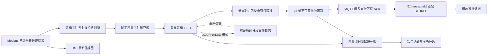

# PLC 有界采样缓冲与补传方案

> **最新进度（2026-10-27，M14实机）：** 接收工具及文档已提交（Hub `0748a14`、Engineer `27070e6`）。IEC20项在隔离断言FB实机全部通过；正式审计v2/boot74保存128条后触发环完整性守卫，完整源窗口未通过，修复取证/追赶后再验。已公开核销并恢复原native-0.5.0/boot75，250GOOD及16批1000值真实入库核验通过、恢复租约释放。现有开发库、唯一后端保持，未创建临时数据库，P06继续后置。见[实机报告](M14实机断言与审计v2受约束验证-20261027.md)。

> **此前进度（2026-10-26，历史记录）：按[JOINT-PLAN/10](三方联调实施与统一验收-20261026.md)继续三方功能，P06仍后置。Python真实授时/配置/2178事件及两批持久恢复分项已通过；PLC授时候选boot63通过47实机断言、授时/控制/250GOOD及114批2240值入库核验，双端归一化配置一致。MCP0.6.3核销后已恢复原native-0.5.0/boot64，250GOOD及24批1500值核验通过，租约释放；完整故障矩阵/独立事件逐槽对标及整体验收仍待验。现有开发库/唯一后端保持。见[最新报告](三方联调-T05-T07实机基本闭环与原工程恢复-20261026.md)。以下容量/性能假设仍需各自验收。**

> **M12 0.6.4接收记录（历史）：** MCP0.6.4/78工具，固定审计核心本地接收通过；原生完整事件对账待M12-S启动/父恢复租约协作，未刷候选。Python2436入口对账分项保留。见[最新接收记录](三方联调-M12接收与启动协作缺口-20261026.md)。
日期：2026-10-23。三方协同入口：[Hub、Python IoT、原生 PLC 协同实施计划](Hub-IoT-PLC协同实施计划.md)。本文保留 NativeGateway 的 PLC/vPLC 原生 IEC/ST 容量、任务与日志细节；采样完整性、时间有效性、真实回执和缺口语义由三方共同约定。Python 也须覆盖采集入口到 SQLite Outbox 之前的缓冲边界，但不照搬原生数据结构或资源参数。本文是设计方案，容量和任务耗时须经各自实现和实机验证后定版，本轮仅修订文档。

共同接口、reportPolicyV1、16 项计数、独立诊断和验收已按[阶段 0 P0/2 定稿](阶段0-三方接口与验收定稿.md)于 2026-10-24 复核修订。资源预算仍需编译/实测，但共同语义不再留给各项目另行选择；本文件旧的局部描述与共同定稿冲突时以后者为准。

## 目标与方案选择

保持现有 50 台子设备、250 点、`cyclic` 模式、5000 ms 采集及上报周期，网关组批间隔 1000 ms、每批最多 64 点、既有 IoT DATA 和 STORED 协议不变。

先交付有界 RAM 采样缓冲，目标是在当前负载下覆盖 5 分钟通信或 Hub 故障，并在恢复后排空积压。需要更长断连及重启恢复时，再启用独立的文件日志模式。两种模式均以 PLC 主任务运行和新数据采集为优先，超过容量后按明确策略淘汰旧数据并报告缺口。

| 模式 | 目标 | 断电边界 | 推进顺序 |
|---|---|---|---|
| RAM | 当前负载下覆盖 5 分钟断连；恢复后补传 | 未确认 RAM 数据可能丢失 | 第一阶段，默认模式 |
| JOURNALED | 候选覆盖 30 分钟断连；恢复已提交的文件记录 | 只保证已完成持久化提交的记录；介质同步及物理断电验收通过后才能宣称断电恢复 | 第二阶段，可选模式 |

上述窗口以资源预检通过、没有主动身份切换或清空、恢复后的持续处理速率高于新增速率为前提。超过窗口不承诺无损；不能为保留遥测而无限占用 RAM、文件空间或阻塞 PLC 任务。

## 当前问题与改造边界

### 三方责任与 Python 已有能力

Hub 负责历史版本/身份、收据去重、事务提交后 STORED 及旧数据不回退最新值；两种 Agent 负责在设备侧保留应上报事件、区分有意合并与缓冲损失、执行配额及报告缺口。已有 DATA/ACK 保持兼容，任何一方都不能仅凭“所有已收到批次均入库”证明源采样完整。

Python 已有 SQLite Outbox，保护成功入队的不可变批次；但 SampleBuffer 满时删除最旧样本、ReportEngine.latest 的窗口合并以及入队拒绝均在不同边界。须先固定 reportMode 允许的选择/合并策略，再检查已选事件会否在阻塞或满载时被覆盖，补齐独立有界接纳和缺口计数。不能把每个原始采样都改成必须上报，也不能重复建设一套替代现有 Outbox。Python 具体职责、限额差异和实施顺序见协同计划，其持久化时间/重启规则见[平台授时方案](MQTT平台授时方案.md)。

### 原生当前问题

当前实现见 [Main.st](../src/Main.st)、[NG_Modbus.st](../src/NG_Modbus.st)、[NG_Types.dt](../src/NG_Types.dt)。

1. `Main.st` 仅在 `QueueCount < 16` 时组包。满队列后采集仍覆盖 `Samples[]`，未组包的中间值不会形成历史记录；此时 `droppedBatches=0` 也可能伴随周期历史缺口。
2. `Samples[]` 同时承担 HMI 最新值和待组包数据。采集与周期上报的相位不同，可能重复发送同一采样时间，或在下一次组包前覆盖中间采样。
3. 已组好的批次保留完整 payload，重发不改变 messageId 和字节；最多 8 批等待业务 ACK。这个正确行为需要保留。
4. 永久 REJECTED 批次占用同一 16 槽队列，积累后会阻塞正常数据。
5. `NG_Store` 的 v4 双槽文件保存配置、身份及启动计数，未保存遥测。配置保存和遥测日志需要各自独立的格式及容量预算。

Hub 验证中，故障窗口的已上报批次均能完整对账，但源采样出现最长 350 秒间隔；恢复后的 20 分钟窗口仍有两处 11 秒源采样间隔。这说明修复不能只扩大 MQTT 批次数量。证据见 [Hub 批次延迟记录](../../PLCnext-Hub-Backend/docs/verification/2026-10-23-native-gateway-batch-latency.md)。

## 采样记录与发送窗口分离

### 采样入口

在 `NG_Modbus` 产生成功结果或本次采集最终失败结果的代码位置生成事件，分配内部采样序号。内部重试未结束时不重复生成失败采样；重复收到同一 TCP 片段也不生成新事件。

事件包含配置身份、稳定点位键、内部采样序号、原始 UTC 时间、单调时间、值及质量，并附本地采样时间有效性/任务代际及历史时间基准归属。保留 `Samples[]` 作为实时视图，但组包不再从一个不断覆盖的最新值槽中重建历史。具体时间门槛遵守平台授时方案；无效时间样本继续本地显示并记未上报数量，不冒用当前 UTC 加入平台历史。

当前 5000/5000 ms 的 cyclic 配置下，每个采集周期的最终结果进入待上报历史一次。周期调度使用单调时间和固定到期基准，避免用“上次组包完成时间 + 周期”不断推迟截止时间。Modbus 耗时造成的实际采样抖动保留原时间，不补造一个恰好 5 秒的样本，也不集中补做已经错过的物理采集。

其他配置按阶段 0 reportPolicyV1：FIRST 和质量变化在所有模式触发，change/change_or_cyclic 按严格大于 deadband 或 bool 变化选择，cyclic/change_or_cyclic 选择名义报告到期后的首个最终结果。poll 比 report 更快时其余事件明确计为策略过滤；不能把全部原始采样都发出。没有新结果不重复发送旧 GOOD 快照，UNKNOWN/STALE 作为一次明确状态转换事件保留检测时间；周期、资格与组包线程完全分开。这是两种 Agent 的目标行为升级，不代表旧程序已经满足。

网格原点为配置/有效采样代际激活时调度计划的首个名义槽，不由首个 UNKNOWN、完成或接纳时刻决定。周期资格决策消费到期槽，即使接纳失败也按应报损失记账，不能再算同一槽漏报；跨 n 个到期槽以真实结果服务最后一槽，前 n-1 个计 missedReportSlots。QUALITY_STATE 不消费周期槽。missedPollCycles 按点/名义槽计，整块 N 点跳过一轮计 N，停用期间不计。完整黄金向量见共同 R01～R14。

采样 UTC 为本地最终完成/状态检测时刻的 TimeProvider 快照，无效时为 null；不以名义截止点或 Hub 接收时刻替代。STALE 按最近最终物理结果后的无结果时长判断；持续 BAD 保留真实 BAD，不按最近 GOOD 年龄覆盖。值/质量基准取同一点/配置/有效代际最新已接纳事件，旧 shadow、落盘完成或 ACK 均不得回退基准。

连接失败影响多个点、质量从 GOOD 转 STALE 等入口也必须接入事件机制。相同质量在每个扫描周期重复赋值不代表新的采样事件，禁止由此把 50 点/秒放大为数千事件/秒。

### 唯一数据所有权

每条已接纳记录只处于一个逻辑位置：事件暂存区、采样 FIFO、不可变批次或死信区。HMI 最新值不是历史记录的所有者。

组包完成并保存不可变 payload、messageId、原采样引用及摘要后，才能从采样 FIFO 移走相应记录；这是所有权转移，数据仍由批次持有。正常成功路径仅在匹配的 STORED 后结束该批数据的保留。超限淘汰及永久拒绝是另行记账的终止路径，不能记为已入库。

时间失效不撤销已经成功的 RAM 接纳：FIFO 历史保持 P，若按明确策略终止才按 L/I/U 记账。恢复后重新生成当前任务令牌，核验原有效时间和历史所有权后物化，保留原样本身份/UTC；不要求捕获修订与当前修订相等。清理旧准备任务/无效 latest 不得静默删除历史，也不允许给未接纳的无效样本回填恢复时间。整机重启仍按 RAM 易失边界处理。

## 容量与资源预算

### 当前负载计算

当前全部 250 点为 cyclic，正常待上报速率为 `250 / 5 = 50 点/秒`。当前 16 批按每批 64 点计算最多约 1024 点，即约 20.48 秒；实际批次可能不足 64 点。

紧凑记录的容量估算暂按每条 64～96 字节，不在每条记录内重复保存 64 字节 deviceId 和 pointId，而是引用不可变配置字典。以下只计算记录本体，不包含索引、批次 payload、字典、日志头和文件空间放大。

| 时间 | 当前 250 点的记录数 | 按 64 字节 | 按 96 字节 |
|---|---:|---:|---:|
| 1 分钟 | 3000 | 0.18 MiB | 0.27 MiB |
| 5 分钟 | 15000 | 0.92 MiB | 1.37 MiB |
| 10 分钟 | 30000 | 1.83 MiB | 2.75 MiB |
| 30 分钟 | 90000 | 5.49 MiB | 8.24 MiB |

这是估算，ST 结构对齐后的 `SIZEOF`、实际字符串缓存及每个 FB 实例都计入最终 RAM 预算；文件格式采用显式字段编码，不依赖 ST 内存布局直接长期兼容。

### RAM 模式候选参数

| 参数 | 候选值与约束 |
|---|---|
| 整个缓冲子系统 RAM 上限 | 4 MiB，包含记录、事件暂存、16 个 payload 槽、索引、历史字典、缺口和死信元数据 |
| 采样记录最大数量 | 最多 32768；编译后按实际记录大小及固定开销核算，可用容量不得突破字节上限 |
| 覆盖目标 | 当前 50 点/秒，断连 300 秒，另预留现有重试最长 60 秒及 25% 突发余量，至少需要 22500 条记录容量 |
| 320 点配置预检 | 同样 5 秒周期时为 64 点/秒，相同预算需至少 28800 条；不能沿用 250 点结论 |
| 最长保留年龄 | 900 秒；数量或字节满时可更早淘汰，这不是 15 分钟完整覆盖承诺 |
| 事件暂存数量 | 512 条，容纳同一周期多个设备的成功、连接失败或质量变化突发 |
| 每次扫描搬运 | 最多 64 个事件；组包初始最多编码 4 个值；实际耗时验收后再调 |
| 活跃批次窗口 | 保留 16 槽、最多 8 批等待业务 ACK，避免同时扩大 Hub 并发压力 |
| 配置字典数量 | 最多 8 个仍被缓冲数据引用的配置代际；满时拒绝新配置，不隐式清空历史 |
| 水位提示 | 70% 提示、85% 告警；100% 执行明确的淘汰策略，不阻塞采集 |

首次启用时必须同时满足记录容量、4 MiB 总预算和 IEC 内存余量。若控制器无法容纳目标容量，报告实际可覆盖时间，不静默降低采集频率或放大内存。vPLC 使用同一策略，但单独验证其运行时内存和调度余量。

配置变化后的流量预检按上报模式、poll/report 周期和质量事件计算。减少周期或改为高频变化上报后，不能继续显示“可覆盖 5 分钟”而不重算。

## 时序 身份与配置变化

内部记录至少包括以下信息：

| 字段 | 作用 |
|---|---|
| 原网关命名空间与采集启动身份 | 防止网关改名或重启后把旧数据归入另一个设备 |
| ConfigEpoch 与 configVersion | 引用采样发生时的不可变点位映射和发布版本 |
| 稳定点位键 | 由字典还原原 deviceId、pointId 和类型，不能只保存会因删点而变化的数组位置 |
| SampleSeq 与时间 | 内部关联、FIFO 和缺口核对；保留原采样 UTC 时间，重试不重写 |
| Value 与 Quality | 保存当时的工程值及质量；非 GOOD 对应 null，不能重做 scale/offset |
| 到达时的单调时间 | 运行期间判断年龄和调度，不受 NTP 回拨影响 |

只将相同 gatewayId、configVersion 和可兼容身份的记录组入一批。配置切换前完成旧事件的转存，随后切换采集视图；旧记录继续使用旧字典，删除点位或移动点池不能改变已缓存历史的含义。字典在最后一条关联数据离开后才释放。

准备发送后冻结整个 JSON payload，包括外层 timestamp、bootId、sequence、messageId 和 values 顺序。重试必须逐字节一致，不能以当前时间重建相同 messageId 的报文。

重启后已 PREPARED 的批次继续发送原 bootId 和原始字节；从未组成过批次的恢复记录可以使用新启动身份创建新消息，但采样时间和原 configVersion 不变。启动计数仍按现有逻辑先持久化，再开始 MQTT。

采样接纳按本地 FIFO，同一发送类别内按可发送项 FIFO 选择；等待确认/退避的项不阻塞其后可发送项。恢复后新数据与历史积压按下文公平预算调度，不再承诺全局严格 FIFO。Hub 可以并发提交并逆序返回 ACK，PLC 按 messageId 与槽位代际匹配，不能按“当前队头”或“最大已确认序号”批量删除。Hub 查询继续按采样时间排序。遇到时间偏差/回拨保留原时间及诊断，按平台授时方案关闭必要的形成/发送门槛，不修改历史值强制递增，也不因增加 clockAdjustment 诊断就宣称仍可正常发送。

重启后的单调时间从新启动重新计数，不能用新的 NowMs 直接减去旧记录中的单调时间。文件恢复记录以可信 UTC 重建年龄；时间尚不可信时暂缓发送并显示 ageUnknown，等待已有校时流程恢复。字节和数量上限始终生效，不能因为时间不可信而无限保留。

## 满载 死信与迟到回执

普通遥测默认使用“保留新数据、淘汰最旧待处理数据”的策略。执行顺序为：先回收已确认数据，再淘汰未发送的最旧记录或整批；已冻结的批次按整批处理，不删掉其中几个点后继续使用原 messageId。

| 情况 | 处理 | 计数含义 |
|---|---|---|
| 从未发送的数据因容量或年龄被淘汰 | 删除最旧记录，写入缺口 | 已知没有送到 Hub，计入 knownUnsentLossSamples |
| 已发送但未确认的批次必须淘汰 | 标记 ABANDONED，停止重试，保留有限 tombstone 后释放整批 | Hub 可能已经提交，计入 uncertainDeliverySamples，不声称确定丢失 |
| 永久 REJECTED | 从正常发送窗口移到有独立配额的死信区 | 不增加 STORED；保留错误码、原消息摘要和样本范围 |
| 死信区满或到期 | 淘汰最旧死信并累计修剪数量 | 原事件已终止，不重复增加 isolated/knownUnsent/uncertain 或生成同一损失的新缺口；有限对账证据被修剪的限制可见 |
| 事件暂存区或写入入口失败 | 立即记录未接纳数量及原因，继续采集 | 不更新成“已缓存成功”，不能静默合并最新值 |
| 已淘汰批次后来收到 STORED | 通过 tombstone 识别迟到结果 | 不删除槽位中后来复用的新批次；更新仍可关联的不确定交付记录 |

缺口 reason/outcome、事件/尝试/快照计数及互斥对账按阶段 0 第 4 节；还须涵盖 TIME_INVALID、VERSION_DISCARD 和 VOLATILE_RESTART。本文 knownUnsentLossSamples、uncertainDeliverySamples、deadSamples 等旧本地标签只可作为展示别名，必须映射共同字段及其 Total/gauge 含义，不能另起统计语义。记录数量、时间、配置和点位范围；未知用 null 并标记不完整，不填入合法点值冒充样本。

旧展示别名固定映射：knownUnsentLossSamples=knownUnsentEventsTotal，uncertainDeliverySamples=uncertainDeliveryEventsTotal（均为本 epoch 曾发生事实，迟到确认不减）；deadSamples=buffer.deadEvents、pendingSamples=buffer.pendingEvents（均为当前快照，可为 null）。前两项不能与当前 pending/dead 相加对账；对账使用共同 E/S/P/L/I/U 集合。

缺口明细本身也固定容量：候选保留最近 64 条，合并相同原因的相邻缺口；明细压缩或淘汰时保留累计计数并标记 detailTruncated。合并后的首尾时间仅表示覆盖范围，不能伪称其间每个采样都丢失。

死信候选上限为 4 个完整 payload 或 64 KiB，以先到者为准，默认最长 10 分钟；超限告警并记录淘汰。它与主缓冲共享总 RAM 或文件配额，不能通过独立死信列表绕过总上限。

## 恢复补传与主任务预算

### 补传速率

采集和上报资格周期保持 5000 ms；恢复时提高的是已缓存记录的发送速率，不是重新采集或伪造采样。

候选总发送限速为 150 点/秒、3 批/秒、48 KiB/秒，三个限制共同生效，所有重试也消耗额度。按原 64 点及 12 KB 值区限制组包，同时预检整个 JSON 能放入 `NG_Json`，不能仅检查拼接前的长度。

当前新增速率为 50 点/秒，若真实 STORED 能持续完成 150 点/秒，净排空速率为 100 点/秒。5 分钟积压的 15000 点约需 150 秒排空；这是速率假设下的计算，不是控制器已达到的实测指标。

通用计算为 `排空时间 = 积压点数 / (实际确认速率 - 新增速率)`。若实际确认速率不大于新增速率，积压不会排空，应保持限速、报告预计覆盖时间和超限风险，不无限提高 MQTT 并发。

该速率还受实际 maxBatchPoints、报文大小、编码速度和 STORED 耗时限制。例如每批降为 32 点、每秒仍最多 3 批时，理论上限已降为 96 点/秒，不能继续套用 150 点/秒的计算。配置预检和验收都使用实际可达到的有效速率。

恢复后先满足当前连接的复校、正常心跳及控制恢复提交，再发送数据；不等待一个并不存在的心跳业务 ACK。新有效数据与恢复前历史积压按 1:1 有界公平预算选择，一方没有可发送项时服务另一方，每类内部 FIFO；组包/窗口分配也须落实公平，不能先用所有槽冻结旧积压、再声称发送器已公平。已冻结或在途批次独立等待 ACK，不为调整顺序改写其字节。历史补传不等待新 GOOD、当前采集启用或期望配置 APPLIED，仍服从显式维护停发及身份/版本/删除边界。保留现有首次 30 秒、之后 60 秒的业务 ACK 等待基线及可重试拒绝处理，加入小幅错峰，防止 8 个槽同时重复发送；所有发送/重试共用总限速，不因 ACK 慢而创建新消息 ID。该公平调度不改变前述净排空公式，但具体排空时间仍以实际确认速率为准。

### 扫描周期

工程当前主任务为 20 ms，生成工具中的看门狗为 500 ms。500 ms 只能作为故障保护，不能作为允许遥测阻塞主任务的预算。

RAM 队列操作采用固定数组、固定次数搬运和索引推进；每次调用没有等待 ACK、等待文件完成或遍历全部历史记录的循环。HMI、数据捕获和 Modbus 状态机继续每周期推进。

新增队列与组包工作以每主周期 1 ms 为初始预算目标，编译后用任务执行时间验证；超过预算应减少每次搬运/编码数量。采集入口同在 Main 任务时可以顺序写入事件暂存区；将文件工作移到低优先级任务时，通过双缓冲和明确的所有权交接交换数据，不能跨任务直接修改共享 FIFO 索引。

验收检查主任务周期超限、看门狗、CPU、实际内存和 IEC 数据内存，并比较改造前后的同负载基线。历史资源百分比不能直接换算成可申请的 ST 字节数，4 MiB 候选预算需实机核实。

## 可选文件日志模式

### 配额与文件结构

JOURNALED 模式候选总文件配额为 32 MiB，含采样分段、未确认 PREPARE 批次、ACK/淘汰标记、配置字典、缺口、死信和整理时的临时空间。候选分配：24 MiB 记录区、2 MiB 字典/检查点、2 MiB 死信/缺口、4 MiB 批次及整理预留；任何区域不得突破总配额。

文件模式仍沿用整个子系统 4 MiB 的 RAM 上限，读写暂存和恢复索引必须纳入该预算，不能在 RAM 模式之外另加一套无上限内存缓存。

目标断连 30 分钟，最长年龄 3600 秒；先到字节/记录上限则先淘汰。按 50 点/秒、96 字节记录计算，30 分钟的记录本体约 8.24 MiB；真实覆盖能力还取决于文件头、字典、日志整理及样本大小，按实际编码和预检结果展示。

采用固定数量的 128 KiB 分段或等效固定文件池，禁止每点一个文件、每次 ACK 重写整个缓存。文件包含格式版本、代际、记录长度、序号范围、CRC 和提交尾标；启动时按文件池顺序分步扫描，截断或隔离最后一个不完整尾部，不能因为一个损坏段抹掉所有健康历史。文件不足、损坏或写失败时进入可观测的降级状态，不占用配置双槽文件。

目录候选为 `/opt/plcnext/ng-buf/`，部署时建立并验证访问权限。所有文件名控制在 80 字符内，遥测同一时刻最多占用 4 个句柄，给配置保存等功能留出余量。官方 [FILE_OPEN](https://engineer.plcnext.help/latest/FILE_OPEN.htm) 说明同时最多打开 8 个文件，并且始终以读写方式打开。

### 写入与恢复事务

记录先进入 RAM 暂存，再按候选不超过 1 秒或一个固定小块合并写入。明确区分 `acceptedSeq` 和 `durableSeq`，只有后者表示已经完成定义好的日志提交。

首次 MQTT 发送前，持久化包含 messageId、完整原始 payload、摘要和采样关联的 PREPARE。PREPARE 完成后可以回收对应原始记录的重复表示，因为其内容已转移到批次日志；整批收到 STORED 后追加 ACK 标记。回收或整理必须确保总有一份有效的数据表示，不能先删除原始记录再等待 PREPARE 完成。

先写日志再发送会增加首次发送前的等待和写入量，需单独测量文件模式的端到端延迟。当前 Hub 验证的 p95=1.672 秒不能直接当成启用该模式后的性能结果；合并写入的 1 秒目标也不等于底层文件操作必定在 1 秒内完成。

| 掉电位置 | 恢复行为 |
|---|---|
| 采样尚未达到 durableSeq | 处于明确的 RAM 易失窗口，不承诺恢复 |
| 采样已提交，尚未 PREPARE | 恢复原采样及配置映射后正常组包 |
| PREPARE 已提交，未发出或 ACK 未持久化 | 重发原始 messageId 和字节；Hub 收据去重 |
| Hub 已入库但 PLC 未记下 STORED | 与上一情况相同，不能以“可能已入库”为由删除 |
| ACK 已提交 | 不再次恢复为待发；允许后续回收该段 |
| 日志整理中掉电 | 根据代际、有效提交尾标及检查点选择仍完整的一份，不先删除唯一有效段 |

`FILE_WRITE.Done`、写入长度检查及关闭后回读属于必要校验，但不能单凭它们宣称物理掉电安全。官方 [FILE_WRITE](https://engineer.plcnext.help/latest/FILE_WRITE.htm) 和 [FILE_CLOSE](https://engineer.plcnext.help/latest/FILE_CLOSE.htm) 分别定义写入与关闭完成状态；介质同步、运行时缓存与控制器掉电边界仍需针对实际版本验证。未完成该验证前，只标注为文件恢复模式，不标注为严格掉电无损。

文件状态机放在低优先级执行路径，不能在主任务中循环等 Done；还须实测单次文件 FB 调用是否造成不可接受的执行时间。配置写入优先于遥测后台整理，文件系统忙时允许缓冲水位上升并按既定上限降级。

### 写盘量

始终记录每个 5 秒采样，会持续消耗存储写入预算。按 64～96 字节原始记录估算，50 点/秒每天约写 0.28～0.41 GB 记录本体；PREPARE 原始 JSON、ACK、字典和整理会增加写入量。默认 RAM 模式无这项持续遥测写盘；启用日志模式前应测量实际每日字节数及放大，并核实介质和运维预算，不能用 32 MiB 的文件配额推断每日只写 32 MiB。

## 配置 升级与身份切换

遥测缓冲的本地设置放在独立、带版本的配置中，至少有 mode、总 RAM/文件字节上限、最长年龄、发送限速和淘汰策略。第一阶段采用受控默认值，后续 HMI 编辑需范围校验；不在 Hub 下发的 v1 config 中直接增加未知字段。

普通点表增删和版本切换不清空历史。字典或容量不足时，按现有配置错误机制返回 RESOURCE_LIMIT，保持当前有效配置，不为了返回 APPLIED 而默默删掉旧数据。

进入本地维护后仍遵守当前 TelemetryAllowed 边界：本地改动不能套用旧 Hub configVersion 上报；旧 Hub 批次保留原身份。实际改变 gatewayId、清空数据或切换到不同身份时，旧缓冲隔离到原命名空间；若用户明确清除，计入 IDENTITY_CHANGE 缺口，不能把旧 payload 改头后发送。

RAM 模式下计划下载或重启前先排空，无法排空时将本次有界数据损失作为维护结果记录；不能把 RAM 模式标成重启可恢复。文件模式升级时保持读取旧日志格式的能力，先验证再迁移，回退不能悄悄删除新格式日志。

## 诊断与 Hub 协同

HMI/RSC 至少提供：mode、pendingSamples、bufferBytes/maxBytes、oldestPendingAge、预计可覆盖时间、activeBatches、inFlight、knownUnsentLossSamples、uncertainDeliverySamples、deadSamples、gapCount、最后缺口时间和原因、captureOverflow、sourceTimestampRepeatCount，以及文件模式的 durableSeq、volatileSamples、storageError、writtenBytes。

保持已部署 heartbeat.queue 结构和各端既有语义：batches/payloadBytes 描述物化队列，不能涵盖采样 FIFO；Python droppedBatches 实际是拒绝入队尝试数，原生 Dropped 不覆盖从未组包的中间样本，二者不能横向等同。新统一统计只进入阶段 0 的 bufferDiagnosticsV1，未组包采样损失不能折成旧批次数，不能以 droppedBatches=0 宣称完整。

按共同定义，16 项 Total 为当前 counterEpoch 已知事实累计下界，不用 null；未知 gauge/缺口数量才用 null，并将 accountingComplete=false 保持到本 epoch 结束。跨线程快照不重复计算 FIFO→冻结批次的所有权转移；重复/倒序诊断不刷新 Hub 的 90 秒新鲜度。完整验收必须保有独立入口记录及事件→原批次→真实收据关联，不能仅以队列统计或曲线点数放行。

现有 v1 DATA、heartbeat 的 schema 均禁止额外字段。因此核心缓冲可先保持旧协议兼容，完整的远程缓冲/缺口展示需要一个明确的最小 Hub 配套：两种 Agent 共用的独立 `diagnostics/buffer` topic、版本化 schema 及 Hub 消费/展示。三方先定最小字段、计数单位和能力差异，不能形成原生与 Python 各自不可比较的缺口口径。旧 Hub 不识别该 topic 时，数据入库仍可工作，但只能依靠本地 HMI/RSC/Python 诊断和导出缺口证据，不能声称平台已有远程缺口告警。该协同不改变现有 DATA/ACK 语义，也不把诊断数据写成采样值。

## 代码改造与交付顺序

| 模块 | 改造职责 |
|---|---|
| `NG_Types.dt` | 增加紧凑采样、配置字典引用、缓冲状态、缺口和批次状态；保留既有配置文件类型兼容 |
| `NG_Modbus.st` | 在成功、最终失败及质量转换处发出带序号的事件；HMI 最新视图单独更新 |
| 新 `NG_Capture` / `NG_ReportPolicy` | 捕获事件、周期/变化上报资格、内部时间与采样序号，拒绝静默覆盖 |
| 新 `NG_HistoryBuffer` / `NG_GapLog` | 固定容量、所有权转移、年龄/字节淘汰、缺口与计数 |
| 新 `NG_BatchBuilder` | 分周期编码、不可变 messageId/payload、完整长度校验、历史配置绑定 |
| `Main.st` 与 `NG_ReadAck` 使用处 | 接入新缓冲、按身份处理乱序 ACK、死信隔离、限速、心跳与控制优先 |
| 新 `NG_TelemetryJournal` | 可选分段写入、PREPARE/ACK、恢复和有预算的整理；独立于 `NG_Store` |
| HMI 与 `tools/build_native.py` | 展示真实水位/缺口/模式；新 POU 会被现有源码扫描收集，但新增任务和标签仍需显式接线与 Engineer 验证 |

三方总体顺序以协同计划为准：先固定共同时间接口、事件资格及交付语义，在已有核验时基下优先补采样链路缺口，再接入公共 MQTT 授时，最后扩展原生文件日志。新现场没有其他可信时基时，最小 MQTT 授时与有效性门槛必须先于带 UTC 的缓冲业务启用。Python 的报文前缓冲与 Hub 诊断/接收回归是同一阶段的配套范围，不能将本文当作只改 PLC 即可完成端到端可靠性。

原生具体实施顺序：

1. **采样事件与 RAM 模式。** 完成容量核算、两类时间问题修复、满载策略、乱序 ACK、死信隔离和 HMI 诊断，先验证 5 分钟断连与持续补传。
2. **共同授时与文件模式前置。** 与 Hub/Python 接入同一时间规则，验收冷启动、时间失效及跨重启年龄；现有局域网时基可用于第一阶段验证，不能据此宣称已交付 MQTT 授时。
3. **文件模式。** 在 RAM 链路和可信时间恢复稳定后验证文件 FB、空间与写入预算，再交付分段日志、故障恢复和物理断电测试。
4. **Hub 共同诊断配套。** 契约在共同设计阶段即固定，消费展示可分步交付；不把新字段直接塞入现有 v1 heartbeat，未上线前不宣称远程缺口已告警。

默认运行模式保持 RAM，文件模式通过资源与恢复验收后才启用。方案阶段不改变当前运行的 v13 点表、固件或采集任务。

## 验收标准

所有故障注入使用隔离网关或明确的维护窗口；本节是后续实施验收清单，并非已经执行的结果。

| 场景 | 通过条件 |
|---|---|
| 正常运行至少 30 分钟 | 50 台/250 点和周期不变；按内部采样序号核对应上报事件，payload/映射/值/时间/质量与入库多重集一致；队列不持续增长 |
| 暂停 STORED 或阻断到 Hub 5 分钟 | Modbus 与主任务继续运行；在接纳预算内无未记账覆盖；恢复后按测得确认速率排空，原样本时间不变 |
| 3 倍恢复速率假设验证 | 记录实际确认点数/秒；只有达到 150 点/秒才使用“150 秒排空 5 分钟积压”的结论，否则使用实测速率重算 |
| 超过字节/记录/年龄上限 | RAM/文件总量严格有界；按策略淘汰；缺口及已知/不确定数量能对账，新采集继续 |
| 8 批逆序、重复、迟到 ACK | 只影响匹配 messageId 和槽位代际；不提前释放后面的批次，重发字节完全相同 |
| Hub 提交后丢弃 ACK | 重试不产生重复入库；不把 MQTT PUBACK 当成 STORED |
| 永久拒绝和死信溢出 | 正常发送窗口能继续工作；死信有界且淘汰留痕 |
| 积压期间改配置或删除点位 | 旧记录仍使用旧版本和字典；达到字典上限时明确拒绝新配置，不错映射或无声清空 |
| NTP 回拨和跳时 | 调度和运行期间年龄依赖单调时间；原采样 UTC 时间和跳时诊断保留，不产生身份重用 |
| 配置保存、HMI 操作与满速补传并行 | 主任务不超期、不触发看门狗；新工作满足约定执行时间预算，CPU/IEC 内存维持稳定余量 |
| 文件模式下重启及物理断电 | 按 durableSeq、PREPARE 和 ACK 提交点恢复；截断、CRC 损坏和整理中断有明确结果，不全盘清零 |
| 文件空间满、写入错误和格式回退 | 不越过配额、不阻塞 PLC；降级可见；无法解释的旧数据隔离并报告，不伪装恢复成功 |

最终按唯一内部事件身份进行互斥集合对账，应满足 `本地应上报事件 = 已确认被 Hub 保存的事件 + 仍待处理事件 + 已知未发送损失 + 明确隔离/拒绝事件 + 交付结果不确定事件`。Hub 查询已证实保存的事件优先归入第一项，即使 PLC 仍在重试，也不重复算入待处理；后续证实提交结果时从“不确定”迁移到相应状态。不能把 Hub 总行数和本地队列长度直接相加。

采集失败产生的 BAD_* 记录仍按上报策略进入应上报事件集合，采集失败次数单独诊断；按 reportMode 有意过滤的事件不进入该集合，不能把它们混成缓冲丢样。

放行证据包括采样/批次关联记录、原始 wire 哈希、Hub 收据及逐点时间和值对账、资源和任务执行时间、所有淘汰/不确定交付记录。仅凭队列回到零、250 GOOD 或 droppedBatches=0 均不足以判定历史完整。

隔离测试使用能区分每次读取的 mock 值或独立采样事件记录器，从采集入口建立应有事件集合；仅查看 DATA 序号连续无法发现“从未组包”的采样缺失。测试关联记录由外部验收程序持续归档，PLC 不为验收另外保存无限历史。
