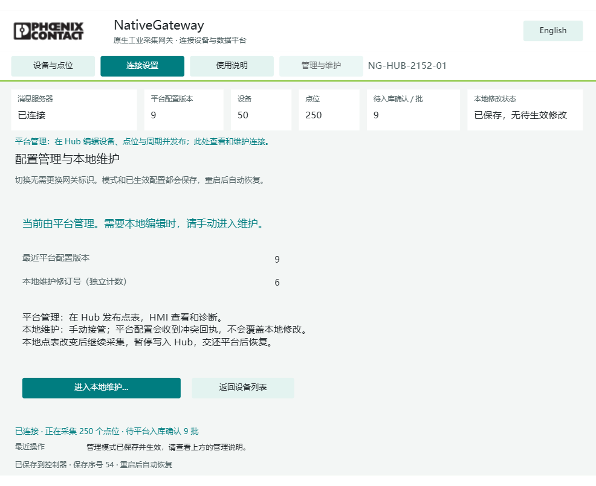

# NativeGateway 管理模式与维护验收

验收日期：2026-10-23。版本：`native-0.5.0`。控制器：AXC F 2152，`192.168.0.8`。网关标识：`NG-HUB-2152-01`。

## 交付与使用

最终工程已在 PLCnext Engineer 中编译为 **0 错误、0 警告**，并下载至 2152。最终下载后 bootId 为 `ng-d4f61b3085b97c5e3831983b-21`。工程 SHA256：

```text
7c0724cdbe18552956b5f111e2c9ae0feb2829f9d28cfa2fd449ffe8bac46154
```

HMI：[打开 NativeGateway](https://192.168.0.8/ehmi/hmiapp.html)。支持中文与英文，使用原生 Engineer Web HMI。



1. 正常使用 **Hub 管理**：在 Hub 修改设备、点位与周期并发布，HMI 查看状态、数据和连接设置。
2. 需要本地处理时，打开 **管理与维护 → 进入本地维护**。确认页默认 **保留当前设备与点表**，不改变网关标识。只有明确选择并确认清空，才清空本地工作配置；平台备份仍保留，也不会删除 Hub 中的设备。
3. 查看确认页、选择清空或取消，都不代表模式已切换。取消后，即使收到旧的确认指令，也不会切换或清空。
4. 维护期间可以本地编辑并保存。平台配置返回明确的 `REJECTED / VERSION_CONFLICT`，不会覆盖维护修改。本地维护修订号独立递增，不占用平台配置版本。
5. 本地点表被修改后，PLC 继续本地采集，但暂停生成发往 Hub 的新遥测，防止用平台旧版本标注不同点表。此前已排队的合法批次仍可完成真实入库回执。
6. 选择 **交还平台管理**并确认：恢复最近一次已保存的平台点表，舍弃维护工作副本及未提交草稿，恢复 Hub 上报。维护期间被拒绝的发布，需要在 Hub **重试原发布**。本地修改不会自动合并回平台，需在 Hub 重新编辑发布。

模式切换与 MQTT 连接设置分别保存。切换不要求更换网关标识，不会主动重连 MQTT。配置、管理归属、平台备份和本地修订使用 v4 双槽文件持久化，可迁移原 v3/v2/v1 文件。

## 实测范围和结果

本轮证据观察范围为 **13:38:45～14:12:24，33 分 39 秒**，包含主动重启和下载。它是维护与恢复功能验收，**不是连续稳定性长测，也不是 8 小时通过**。

| 项目 | 实测结果 |
|---|---|
| 默认进入维护 | 同一标识，50 台、250 点完整保留，配置内容逐字段相等 |
| 本地编辑 | 仅将首点采集周期从 5000 改为 6000 ms，平台版本与 messageId 保持，平台备份未改变 |
| 平台发布冲突 | Hub 真实发布 v8，收到 REJECTED / VERSION_CONFLICT；说明要求交还 Hub 后重试 |
| 维护中 OS 重启 | 实际观察 RSC 服务离线，bootId 19→20；维护模式、6000 ms 修改、本地修订和平台备份全部恢复 |
| 重启后重放配置 | 重发原 Hub 命令字节，仍返回维护冲突，无覆盖 |
| 交还与真实重试 | 恢复平台 v7 原表，首点回到 5000 ms；Hub 原发布重试成为 APPLIED v8 |
| 恢复测试策略 | 最终下载版本接受 Hub v9，批次间隔从测试用 1100 恢复原 1000 ms；50×5 点表不变 |
| 最新界面确认与取消 | 实测选择清空后取消、取消后旧确认、默认保留接管、本地编辑、交还确认后取消及再次正式交还，全部符合预期 |
| 同一身份与会话 | 最新版本整个模式切换周期网关标识、bootId、MQTT sessionId 均不变 |
| 维护数据隔离 | 已改本地表的约 490.78 秒窗口，新生成的 Hub 遥测批次为 0；观察到 11 个此前已排队批次 |
| PLC 实时采集 | 250 点 GOOD，值与 mock 预期一致，采样年龄不超过 20 秒 |
| Hub 最新值 | 50 台各 5 点，共 250 点 v9；GOOD、值、来源网关及最终 bootId 全部正确；查询时年龄 8.34～20.21 秒 |
| 真实回执 | 汇总时最终 bootId/v9 的 61 个批次取得真实 Hub STORED，覆盖全部 250 点；记录器不生成业务回执 |
| 协议与数值 | 校验 2127 条本轮协议报文，schema 错误 0、GOOD 数值错误 0；排除历史旧数据行 |
| 最终控制器 | Hub 管理、v9、无本地修改，保存序号 54；Dropped 0、InvalidAcks 0 |

最初重启测试使用同一 native-0.5 通信及持久化实现，随后修复了界面在确认前提前显示目标管理模式的问题并重新编译下载。最终工程再次完成取消、保留、编辑、交还及 v9 实际入库验收。`Main.st`、`NG_Store.st`、`NG_Command.st`、`NG_Mqtt.st`、`NG_Modbus.st` 和数据类型源码的哈希在两次构建间完全一致；仅界面编辑功能块与提示翻译修正。重启恢复记录中的 135.06 秒包含人工恢复检查等待，不能解释为精确自动恢复耗时。

## Hub 心跳滞后排查

发现两个有独立证据的因素：

- **PLC 与 Hub 时钟偏差。** 原始心跳时间戳曾比本机接收时间快约 0.03～0.85 秒。Hub `IoTStateService.accept` 对任何未来时间戳直接返回，不更新在线证据。对应诊断时 STATE 队列深度为 0、工作线程空闲，排除了该时段持续队列堵塞的解释。结果是 MQTT 持续有心跳和数据，Hub 的当前会话/最后心跳仍停留在旧值，发布预览报 `PATCH_CAPABILITY_UNAVAILABLE`。
- **数据库锁等待。** 另一次线程转储显示 `iot-state` 等待 `IoTStateMapper.lock`，控制线程等待 `observeGet`；只读 `pg_stat_activity` 发现事务阻塞链及写设备状态事务。Hub 启动以来累计诊断曾记录 STATE 执行最长约 83.74 秒、排队最长约 127.97 秒。这些累计最大值不能全部算作本轮 PLC 故障，也不能忽略对页面和发布时延的影响。

已按 [Phoenix Contact 官方时钟设置说明](https://engineer.plcnext.help/latest/DeviceParam_RealTimeClock.htm)，通过 Engineer Cockpit 时钟按钮向 PLC 写入联调主机时间。随后抓到的心跳不再超前，Hub 建立最终 boot21 会话，配置与实际版本一致为 v9，`config_drift=false`，发布及真实入库通过。未修改 Hub 业务代码、未人工改数据库、未伪造回执。

延伸检查记录了校时后连续 20 条心跳，均未超前本机接收时间，差值为 -2.0561～-0.7099 秒。该差值包含秒级时间分辨率与网络传输，不能当成精密时钟误差测量。

这是本次联调的校时恢复，不代表交付了持续 NTP 服务。正式部署应使 PLC 与 Hub 持续使用一致时间源；现有 Hub 的零未来偏差容忍仍然存在。远程开发数据库时钟也与 Hub 有偏差，因此不能直接把数据库 `now()-last_heartbeat_at` 当成 Hub 在线判断的实际年龄。数据库事务性能需在 Hub 项目另行优化；本轮保留原实现，未用放宽时间或数值检查掩盖问题。

## 资源与边界

本轮 191 个资源样本：CPU 35～90%，实际内存 56～70%，包含主动下载与重启。最终下载后约 14:00～14:12 的 74 个样本：CPU 35～82%，实际内存始终 70%，IEC 数据内存 45～46%，IEC 程序内存 10%。不能据此宣称长期无内存增长；高点数持续运行仍需要另开长测。

本轮没有实际执行“清空配置”选项，只验证选择后取消与默认保留；不将未执行分支算作删除验收。遥测仍使用 16 批 RAM 队列，断电待发数据不保证保留。Hub 数据库有延迟时队列可能积压，本轮最终读数为 13 批、丢弃 0。

## 证据和复现

- Git 内精简结果：`tests/validation/maintenance-mode-results.json`、`maintenance-heartbeat-diagnostic.json`、`maintenance-source-hashes.json`。
- 原工作站完整证据：`tests/mode-maintenance-20261023/`，含各阶段状态、Hub 发布详情、重启探测和截图；原始报文与 10 秒资源采样位于 `tests/hub-runtime/`。这些运行日志不上传。
- 可重复工具：`tests/maintenance_mode_verify.py PHASE`，`tools/summarize_maintenance.py --check-hub`。它们依赖已建立的隔离 Hub fixture；有运行影响的阶段见 `tests/README.md`。
- 原先 8 小时测试按用户要求提前结束，其 38 分 50.6 秒记录及 HMI 短暂不可用异常仍保留，不混入本轮通过结论，也未重新启动自动监测任务。
